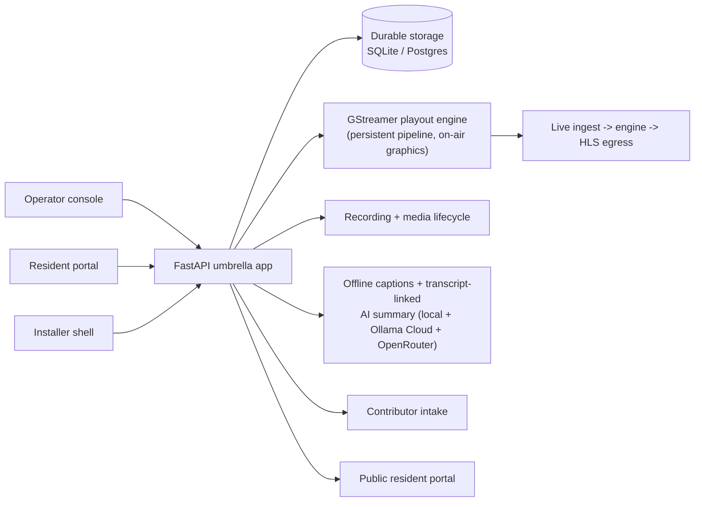

# CivicCast

**CivicCast `v1.0.0-beta.15` is the current signed native Windows pre-release.** CivicCast is a station-in-a-box for public-access and local-government media: record and broadcast meetings, review captions, prepare sourced summaries, schedule programs, and publish recordings to a resident portal. Optional cloud services may charge their own usage fees; CivicCast has no per-minute software fee.

The [Beta 15 release page](https://github.com/scottconverse/civiccast-native/releases/tag/v1.0.0-beta.15) provides the signed installer, runtime packs, complete signed station-model download, manuals, and checksums. The [Beta 15 verification record](docs/releases/v1.0.0-beta.15-verification.md) identifies the package and states its evidence limits. Start with [Install CivicCast on Windows](INSTALL-WINDOWS.md), the [User Manual](docs/USER-MANUAL.md), or the [FAQ](FAQ.md).

The original signed Beta 15 candidate (source `7899ee9234428b0b3c93b369392ae5114d292533`, build `38341135764`, setup SHA-256 `877f344d9ac1b2dfe8b24ecb9f91ba936d4b4b87eb26a2427cf4abcedcfbd37d`) completed one fresh offline Windows Sandbox installation in 14 minutes 49 seconds. The service registered, activated the station, and reported healthy at the current schema. That candidate's native wizard and Help rendered; normal-user and SYSTEM password-file ACL probes passed; a metadata-simulated downgrade was refused before installation changes; and the bundled 20-second Welcome sample reached slate after playback. The [Beta 15 verification record](docs/releases/v1.0.0-beta.15-verification.md) identifies the tested package and separates it from the refreshed manual/Help bytes in this release edition. Beta 14's earlier five output observations and normal development-host upgrade remain historical evidence in its [own verification record](docs/releases/v1.0.0-beta.14-verification.md); Beta 13 results remain in its [record](docs/releases/v1.0.0-beta.13-verification.md).

**Historical Beta 11 host result: 72 hours, three channels, 99.78% live caption-input coverage.** The host ran Public, Government and Education together without a service restart, with 216 healthy scheduled checkpoints. See the [72-hour host report](docs/ops/beta11-host-caption-performance-72-hour-2026-10-11.md) for the recorded measurements.

The live-caption path automatically retries Whistle while Whisper supplies backup captions. Whistle remains the CPU live-caption primary; supported NVIDIA CUDA applies to Whisper only. The native installer registers a Windows service and supervises the control plane, PostgreSQL, and media workers from the bundled runtime. This repository is the native Windows product line; it has no WSL, Docker, or Linux installation target. See [BRANCHES.md](BRANCHES.md) for project history.

Current release state is recorded in [`docs/releases/release-truth.yaml`](docs/releases/release-truth.yaml). Earlier package and lab evidence remains available in its release records, including the [Beta 11 verification](docs/releases/v1.0.0-beta.11-verification.md) and [Beta 10 verification](docs/releases/v1.0.0-beta.10-verification.md); those records apply only to their named releases.

## Install and run

Download the signed Beta 15 station with the Windows helper. It obtains the installer, runtime packs and required station models, verifies them, and installs without separately installed development tools:

```powershell
$installerScript = Join-Path $env:TEMP 'CivicCast-Install-Beta15.ps1'
Invoke-WebRequest -UseBasicParsing -Uri 'https://github.com/scottconverse/civiccast-native/releases/download/v1.0.0-beta.15/download_windows_release_artifacts.ps1' -OutFile $installerScript
powershell.exe -NoProfile -ExecutionPolicy Bypass -File $installerScript -Install -Destination "$env:USERPROFILE\Downloads\CivicCast-Beta15"
```

Keep the PowerShell window open until it reports **Done**. During silent setup,
the installer writes a timestamped progress heartbeat before and after each
step to `C:\ProgramData\CivicCast\install-progress.log`; its latest line
names the step in progress.

See [Install CivicCast on Windows](INSTALL-WINDOWS.md) for first setup, existing installations, offline copies and password recovery. Open **CivicCast Operator Console** after setup finishes.

The [User Manual](docs/USER-MANUAL.md) ([PDF](docs/USER-MANUAL.pdf), [Word](docs/USER-MANUAL.docx)) covers operation, installation and architecture. Online manual revisions reach installed copies with a replacement application package. Additional guides: [Admin](docs/admin-guide.md), [Meeting Operator](docs/meeting-operator-guide.md), [Records Clerk](docs/records-clerk-guide.md) and [Tester Start Here](docs/tester/START-HERE.md).

### Developer — run from source, contribute

```bash
# One-time: install uv, then sync the workspace.
uv sync --all-extras --group dev

# Print the release version.
uv run civiccast --version

# Probe CPU, RAM, disk, GPU/VRAM, OS, and recommended tier.
uv run civiccast doctor

# Serve the umbrella API on http://localhost:8000.
uv run uvicorn civiccast.app:app --reload
```

In a standalone `uvicorn` developer run, CivicCast can start in local setup
mode and prepare managed SQLite storage when `DATABASE_URL` is unset. This is
not the native Windows service default; that service uses its installer-
provisioned PostgreSQL database. In-memory stores are for tests and local
experiments only and require explicit acknowledgement.

Technical references:

- [Architecture Overview](ARCHITECTURE.md)
- [3.0 Master Spec](docs/spec/3.0/civiccast-3.0-station-in-a-box-MASTER.md)
- [Roadmap Status Manifest](docs/spec/3.0/ROADMAP.status.yaml) (repo-verified
  — a **Built** status means the code and tests named as evidence exist on
  disk, not that a feature has field proof for live media, hardware,
  headends, providers, or unattended station operation)
- [Reconciliation Log](docs/spec/3.0/RECONCILIATION.md)
- [Technical Operations Reference](docs/technical-ops-reference.md)
- [API Guide And Generated Reference](docs/API-REFERENCE.md)
- [OpenAPI JSON](docs/openapi.json)
- [Legal Notices](LEGAL-NOTICES.md)
- [Patent Risk Notes](docs/legal/patent-watchlist.md)

## Architecture

CivicCast is a self-hostable FastAPI service with React/Vite frontends
(operator console, resident portal, installer shell), a persistent
GStreamer playout engine, and a clean separation between data, service,
API, and UI per module.



The [Architecture Overview](ARCHITECTURE.md) goes deeper into module
boundaries and security boundaries.

## The broader 3.0 spec and roadmap

The [3.0 Master Spec](docs/spec/3.0/civiccast-3.0-station-in-a-box-MASTER.md)
describes CivicCast's full intended station-in-a-box scope — well beyond
what this release has proven in the field — including 24/7 multi-channel
playout, underwriting/spot trafficking, franchise reporting, and native OTT
apps. The [Roadmap Status Manifest](docs/spec/3.0/ROADMAP.status.yaml) is a
repo-verified, fail-closed manifest that checks each spec item's claimed
status against evidence that actually exists on disk; treat "Built" there
as "the code and its tests exist," not as a field-proven claim for this
release. The Beta 15 verification record describes the current package
boundary, and the Beta 11 host report is separately scoped historical runtime
evidence.

Proprietary-appliance capabilities are **out of scope** for V1 by explicit
decision, documented in
[RECONCILIATION.md](docs/spec/3.0/RECONCILIATION.md): multi-site
federation, SCTE-35 dynamic ad-insertion, and FCC EAS **certification**
(mandatory Part 11 relay is the cable operator's headend device — CivicCast
displays CAP/IPAWS and never claims "EAS-compliant").

## Documentation

- [Documentation Index](docs/index.html)
- [User Manual](docs/USER-MANUAL.md)
- [FAQ](FAQ.md)
- [Operator Language Guide](docs/operator-language-guide.md)
- [3.0 Master Spec](docs/spec/3.0/civiccast-3.0-station-in-a-box-MASTER.md)
- [Roadmap Status Manifest](docs/spec/3.0/ROADMAP.status.yaml)
- [Legal Notices](LEGAL-NOTICES.md)
- [GitHub Issues](https://github.com/scottconverse/civiccast-native/issues) (GitHub Discussions is not enabled on this repository)

## Contributing

See [CONTRIBUTING.md](CONTRIBUTING.md). Contributions are accepted via
pull request under the Developer Certificate of Origin (DCO).
Conventional Commits are required.

## License

- **Code:** [Apache License 2.0](LICENSE-CODE).
- **Documentation:** [Creative Commons Attribution 4.0 International](LICENSE-DOCS).
- **Combined repository license:** see [LICENSE](LICENSE).

## Security

To report a security vulnerability, see [SECURITY.md](SECURITY.md). Please
do not open public issues for security reports.

## Support

See [SUPPORT.md](SUPPORT.md).

## Code Of Conduct

This project adheres to the [Contributor Covenant 2.1](CODE_OF_CONDUCT.md).
By participating, you agree to abide by its terms.
