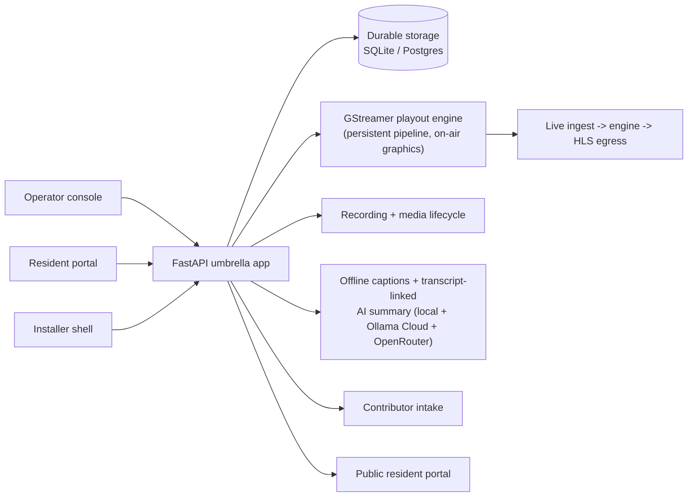

# CivicCast

CivicCast brings station scheduling, channel playout, meeting recording, caption
review, sourced summaries, and resident publication into one native Windows
system. Staff use one operator console; residents watch through a separate
portal. Optional cloud services may charge their own usage fees, while CivicCast
has no per-minute software fee.

## RC3 development

`v1.0.0-rc.3` is an **unpublished candidate** incorporating the 31 R7/R9 operator findings. It is not available as a public release. Source changes cover clean-install and upgrade permissions, credential redaction, backup/restore destinations, delivered captions, scheduling, truthful health/reporting, and matching manual/help. Required CI and isolated installed acceptance remain pending; source checks alone do not establish a working installed candidate. Human language review remains pending and nonblocking.

## Current published package

[`v1.0.0-rc.2`](https://github.com/scottconverse/civiccast-native/releases/tag/v1.0.0-rc.2)
is the current published native Windows pre-release. The [RC2 package record](docs/releases/v1.0.0-rc.2-verification.md)
identifies its signed source and verification limits. Unchanged model packs come from the existing Beta20 release.
The 31-fix RC3 source changes are not in the published RC2 download.

## Previous published package (Beta 19)

The signed Beta 19 [release page](https://github.com/scottconverse/civiccast-native/releases/tag/v1.0.0-beta.19)
provides the installer, runtime packs, station-model bundle, manuals, and
checksums. The [Beta 19 verification record](docs/releases/v1.0.0-beta.19-verification.md)
identifies the exact package and its scoped verification results. For
installation, begin with [Install CivicCast on Windows](INSTALL-WINDOWS.md);
for Beta 19 operation, use the manual bundled on that release page. The
[source manual](docs/USER-MANUAL.md) documents current source and may differ from
the Beta 19 bundled manual; use the bundled manual for that historical installer.
[Sprint 6](docs/ops/sprint6.md) tracks preparation improvements, webhook and Roku
corrections, and station integrations.

The working manual also corrects older operating instructions and refreshes the
CLI/API/settings references. These documentation corrections do not replace the
Help inside an existing installation.

Whistle is the CPU live-caption primary; Whisper supplies per-channel backup
captions, with supported NVIDIA CUDA applying to Whisper only. The native
installer registers a Windows service and supervises the control plane,
PostgreSQL, and media workers from the bundled runtime. This repository carries
the native Windows product line, with no WSL, Docker, or Linux installation
target. See [BRANCHES.md](BRANCHES.md) for project history. Current release
identities are recorded in
[`docs/releases/release-truth.yaml`](docs/releases/release-truth.yaml).

## Install and run

Download the signed RC2 station with the Windows helper. It obtains the installer, runtime packs and required station models, verifies them, and installs without separately installed development tools. Use Windows 11 x64 and a Windows administrator account. Allow about **100 GB free** when preparation and installation share a drive (including roughly **22 GB of model downloads**), plus recording space. Keep the complete kit for offline installation:

```powershell
$installerScript = Join-Path $env:TEMP 'CivicCast-Install-RC2.ps1'
Invoke-WebRequest -UseBasicParsing -Uri 'https://github.com/scottconverse/civiccast-native/releases/download/v1.0.0-rc.2/download_windows_release_artifacts.ps1' -OutFile $installerScript
powershell.exe -NoProfile -ExecutionPolicy Bypass -File $installerScript -Install -Destination "$env:USERPROFILE\Downloads\CivicCast-RC2"
```

Keep the PowerShell window open until it reports **Done**. During silent setup,
the installer writes a timestamped progress heartbeat before and after each
step to `C:\ProgramData\CivicCast\install-progress.log`; its latest line
names the step in progress. If a download is interrupted, rerun the same command with the same destination; verified matching files are reused. If setup fails, keep its exact exit code and progress log and follow the recovery table in the installation guide. Do not uninstall or delete station data to retry.

See [Install CivicCast on Windows](INSTALL-WINDOWS.md) for first setup, existing installations, offline copies and password recovery. Open **CivicCast Operator Console** after setup finishes.

The [RC3 source manual](docs/USER-MANUAL.md) describes the candidate controls. The published RC2 manual ([PDF](docs/USER-MANUAL.pdf), [Word](docs/USER-MANUAL.docx)) covers that package's operation, installation and architecture. Online manual revisions reach installed copies with a replacement application package. Additional guides: [Admin](docs/admin-guide.md), [Meeting Operator](docs/meeting-operator-guide.md), [Records Clerk](docs/records-clerk-guide.md) and [Tester Start Here](docs/tester/START-HERE.md).

### Developer — run from source, contribute

Source contributors can inspect the [station operations record](docs/ops/station-operations-goal.md),
[Sprint 2](docs/ops/sprint2-unattended.md), and
[Sprint 3](docs/ops/sprint3-output-completion.md) for the implementation scope
and focused evidence behind Beta 16. Use the current published RC2
release page for installation.

```bash
# One-time: install uv, then sync the workspace.
uv sync --all-extras --group dev

# Print the release version.
uv run civiccast --version

# Probe CPU, RAM, disk, GPU/VRAM, OS, and recommended tier.
uv run civiccast doctor

# Serve the umbrella API on http://localhost:8000.
uv run uvicorn civiccast.app:app --reload
```

In a standalone `uvicorn` developer run, CivicCast can start in local setup
mode and prepare managed SQLite storage when `DATABASE_URL` is unset. This is
not the native Windows service default; that service uses its installer-
provisioned PostgreSQL database. In-memory stores are for tests and local
experiments only and require explicit acknowledgement.

Technical references:

- [Architecture Overview](ARCHITECTURE.md)
- [3.0 Master Spec](docs/spec/3.0/civiccast-3.0-station-in-a-box-MASTER.md)
- [Roadmap Status Manifest](docs/spec/3.0/ROADMAP.status.yaml) (repo-verified
  — a **Built** status means the code and tests named as evidence exist on
  disk, not that a feature has field proof for live media, hardware,
  headends, providers, or unattended station operation)
- [Reconciliation Log](docs/spec/3.0/RECONCILIATION.md)
- [Technical Operations Reference](docs/technical-ops-reference.md)
- [API Guide And Generated Reference](docs/API-REFERENCE.md)
- [OpenAPI JSON](docs/openapi.json)
- [Legal Notices](LEGAL-NOTICES.md)
- [Patent Risk Notes](docs/legal/patent-watchlist.md)

## Architecture

CivicCast is a self-hostable FastAPI service with React/Vite frontends
(operator console, resident portal, installer shell), a persistent
GStreamer playout engine, and a clean separation between data, service,
API, and UI per module.



The [Architecture Overview](ARCHITECTURE.md) goes deeper into module
boundaries and security boundaries.

## The broader 3.0 spec and roadmap

The [3.0 Master Spec](docs/spec/3.0/civiccast-3.0-station-in-a-box-MASTER.md)
describes CivicCast's full intended station-in-a-box scope — well beyond
what this release has proven in the field — including 24/7 multi-channel
playout, underwriting/spot trafficking, franchise reporting, and native OTT
apps. The [Roadmap Status Manifest](docs/spec/3.0/ROADMAP.status.yaml) is a
repo-verified, fail-closed manifest that checks each spec item's claimed
status against evidence that actually exists on disk; treat "Built" there
as "the code and its tests exist," not as a field-proven claim for this
release. The [RC2 verification record](docs/releases/v1.0.0-rc.2-verification.md)
describes the current published package boundary and scoped acceptance, and the Beta 11
host report is separately scoped historical runtime evidence.

Proprietary-appliance capabilities are **out of scope** for V1 by explicit
decision, documented in
[RECONCILIATION.md](docs/spec/3.0/RECONCILIATION.md): multi-site
federation, SCTE-35 dynamic ad-insertion, and FCC EAS **certification**
(mandatory Part 11 relay is the cable operator's headend device — CivicCast
displays CAP/IPAWS and never claims "EAS-compliant").

## Documentation

- [Documentation Index](docs/index.html)
- [User Manual](docs/USER-MANUAL.md)
- [FAQ](FAQ.md)
- [Operator Language Guide](docs/operator-language-guide.md)
- [3.0 Master Spec](docs/spec/3.0/civiccast-3.0-station-in-a-box-MASTER.md)
- [Roadmap Status Manifest](docs/spec/3.0/ROADMAP.status.yaml)
- [Legal Notices](LEGAL-NOTICES.md)
- [GitHub Issues](https://github.com/scottconverse/civiccast-native/issues) (GitHub Discussions is not enabled on this repository)

## Contributing

See [CONTRIBUTING.md](CONTRIBUTING.md). Contributions are accepted via
pull request under the Developer Certificate of Origin (DCO).
Conventional Commits are required.

## License

- **Code:** [Apache License 2.0](LICENSE-CODE).
- **Documentation:** [Creative Commons Attribution 4.0 International](LICENSE-DOCS).
- **Combined repository license:** see [LICENSE](LICENSE).

## Security

To report a security vulnerability, see [SECURITY.md](SECURITY.md). Please
do not open public issues for security reports.

## Support

See [SUPPORT.md](SUPPORT.md).

## Package evidence and limits

The Publish screen makes the resident portal public by default; archive and
YouTube destinations are separate, opt-in provider workflows. Real external
adapters are environment-gated, and credentials saved in Provider setup do not
enable those adapters. The optional Podcast surface creates an MP3 and RSS
entry from a local recording; subscriber notices use configured mail or
webhook providers with delivery receipts. See the [capability matrix](CAPABILITIES.md) for current-source
behavior and its package boundary.

The Beta 15 package passed scoped Windows Sandbox installation, first-admin
setup, installed Help, uninstall, simulated activation-failure restoration, and
a short Welcome-programme rollover check. Its [verification
record](docs/releases/v1.0.0-beta.15-verification.md) binds those results to
the named package. A separate Beta 15 R9 field evaluation later sampled slate
during scheduled speech, found a CG playlist advertising missing segments,
observed an unsigned installed native executable while the setup executable
was signed, and found a caption-range mismatch after trimming. Causes and
follow-up workflows remain as stated in the [owner-deferred Beta 17
backlog](docs/ops/beta17-deferred.md); these are Beta 15 observations, not Beta
16 package results.

**Historical Beta 11 host result:** 72 hours across Public, Government, and
Education, with 99.78% live caption-input coverage and 216 healthy scheduled
checkpoints. See the [72-hour
report](docs/ops/beta11-host-caption-performance-72-hour-2026-10-11.md). This
result remains Beta 11 evidence and does not qualify later packages.

## Code Of Conduct

This project adheres to the [Contributor Covenant 2.1](CODE_OF_CONDUCT.md).
By participating, you agree to abide by its terms.
