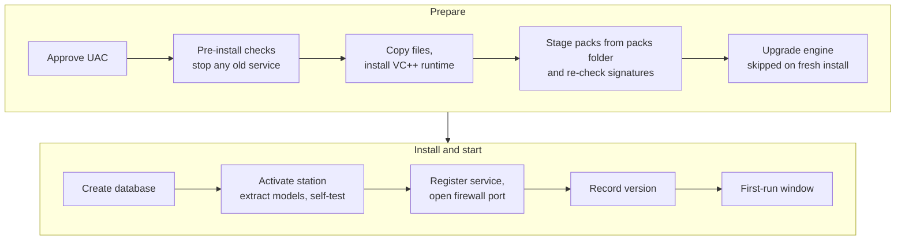

# Installing, first run, upgrading, uninstalling {#ch-installing}

This chapter describes Beta 15 Windows setup, the first-run window and first setup in the operator console. It also covers setup exit codes, logs, upgrade, repair and uninstall. The steps below are based on the current installer and runtime sources. The [Beta 15 verification record](https://github.com/scottconverse/civiccast-native/blob/main/docs/releases/v1.0.0-beta.15-verification.md) identifies the package checks and limits. Read [Chapter 9](#ch-planning) first.

## Before you start

- For a first install, use the release-matched helper linked in [Install CivicCast on Windows](https://github.com/scottconverse/civiccast-native/blob/main/INSTALL-WINDOWS.md). Its `-Install` option verifies `station-models.json` and every matching `station-models.zip.*` part, assembles the complete kit, then runs setup with `/S`.
- You checked the installer's hash and signature ([Chapter 9](#ch-planning), "Download and verify what you need").
- You have a Windows administrator account. Allow about 55 GB on the install drive for a prepared offline kit, or about 100 GB when the download preparation and installation share one drive, plus space for media and recordings.
- The computer will stay on, awake and connected to power for the whole install.
- For an upgrade, you also have a backup and you accept that the station goes off air while setup runs.

> **Note:** Use only a package listed on the [releases page](https://github.com/scottconverse/civiccast-native/releases) or named by the active owner-authorized handoff. A previous release's verification record does not qualify the package you install. Keep a separate backup and a station recovery path before upgrading.

## What the release and local kit contain

Setup has two phases. The **Windows setup** (`setup.exe`) runs with administrator rights and does the installation work: it copies the program, checks components, provisions the database, activates the station and registers the Windows service. Then the **first-run window** ("CivicCast (Native) Setup") opens as a normal user and offers a separate acquisition flow. Silent `/S` setup does not open that GUI or automatically fetch its models. A GUI download is not proof that a model is active.

| What you start with | Installer behavior | Package evidence |
| --- | --- | --- |
| Complete offline kit: setup, runtime packs under `packs\`, signed index and station packs under `station\` | Verifies signed components and activates the local station | Use the record matching the package; see the Beta 15 verification record for this release |
| Release download helper with `-Install` | Downloads and verifies the complete set, creates the folder layout, then runs setup | Use all matching archive parts and release checksum metadata |
| Raw caption or AI model downloads from the first-run GUI | Acquires required and selected optional components | Does not replace signed activation packs |
| Incomplete kit or mismatched station resources | Reports the missing or invalid component; activation cannot complete | Obtain the matching complete kit before retrying |

The complete kit has five runtime packs and a signed station index with six station packs. Whistle is part of that signed set. The release helper assembles the complete kit from the matching release assets.

```text
CivicCast-kit\
  setup.exe              (a kit may use a different file name)
  packs\
    native-app-payload.ccpack
    native-server-binaries.ccpack
    native-ffmpeg-runtime.ccpack
    native-ollama-runtime.ccpack
    native-cuda-runtime.ccpack    (optional GPU libraries)
  station\
    station-index.json
    core.ccpack
    captions-floor.ccpack
    summary-gemma4-12b.ccpack
    summary-gemma4-e4b.ccpack
    translation-translategemma-4b.ccpack
    captions-whistle.ccpack
  QUICKSTART-OPERATOR.md
```

Place runtime packs in the `packs\` subfolder beside `setup.exe`. The four runtime packs other than `native-cuda-runtime.ccpack` are required; CUDA is optional. The signed station index lists `core`, `captions-whistle`, `captions-floor`, `summary-gemma4-12b`, `summary-gemma4-e4b` and `translation-translategemma-4b`. The helper places their matching `.ccpack` files under `station\`. Verify files against the matching release metadata or local kit receipt.

> **Note:** Windows setup stages signed runtime packs under the `packs\` subfolder beside `setup.exe`. The release helper verifies and assembles the separate station-model archive into the kit; setup itself does not fetch missing station packs. The first-run window's model and caption acquisition does not replace the signed station index or station packs needed for activation. Silent `/S` setup skips that GUI acquisition flow.

> **Tip:** Run setup from a local drive or a USB drive. A network share that you mapped to a drive letter in your own Windows session is usually not visible to the elevated setup (standard Windows behavior; not tested with CivicCast). Use the UNC path or copy the kit.

## How the install runs



*Figure 10.1. The order of the Windows setup steps and the first-run window.*

Each box is a step that writes a line before and after to `C:\ProgramData\CivicCast\install-progress.log`. If a step fails, setup stops, shows a dialog (when it is not silent) and exits with that step's code. After files are replaced, any failure also **stops the CivicCast service and sets it to manual start**, so that it cannot start on a half-updated install. Re-running setup is the supported recovery after correcting a recoverable cause. An incomplete kit cannot supply missing signed station packs; obtain the complete matching bundle first.

## Install from the kit

The page order of the standard Windows setup comes from a template that is not in the project's repository, so we could not confirm the exact sequence or wording of its standard pages. The text below that is in quotation marks comes from the project's own files.

### Step 1: Start setup and approve the prompt

1. Use the downloaded release helper with `-Install`. For an already prepared complete offline kit, run `Start-Process .\setup.exe -ArgumentList '/S' -Verb RunAs -Wait -PassThru` in PowerShell from the kit folder and check that `ExitCode` is 0. This supported route skips the separate acquisition window described below.
2. If Windows shows **Windows protected your PC**, follow [Chapter 9](#ch-planning) (check hash and signature first, then **More info**, then **Run anyway**).
3. Approve the administrator (UAC) prompt.

If CivicCast (Native) is already running, setup says "CivicCast (Native) is running! Please close it first then try again." or offers to end it ("Click OK to kill it"). If it cannot end it: "Failed to kill CivicCast (Native). Please close it first then try again".

If WebView2 is missing, setup installs the full offline copy it carries (the build configuration says "offlineInstaller", installed silently). The details list should show "Installing WebView2...", then "WebView2 installed successfully". The setup text also defines a line "Downloading WebView2 bootstrapper...", but that belongs to a download mode this build does not use, so we do not expect to see it; we could not confirm the exact lines on screen. On failure: "Failed to install WebView2! The app can't run without it. Try restarting the installer."

### Step 2: The "Already Installed" page (only if CivicCast is on the computer)

Before the normal setup pages or prerequisite installers, Beta 15 checks the installed CivicCast version. If the installed version is newer, setup exits with code 129 before installing prerequisites, stopping the service, replacing application files, or changing station data. Keep using the installed version, or use its complete matching signed setup kit if it needs repair. If setup cannot safely read or compare the installed version, it exits with code 130 before changing the installation; follow the message and contact support if it persists.

If that check passes, NSIS may show its **Already Installed** page with the installed version and choices such as **Add/Reinstall components** and **Uninstall CivicCast (Native)**. For an upgrade, choose the option that does **not** uninstall first. See "Upgrade" below for why. The older silent-installer downgrade message is historical; Beta 15 refuses a downgrade in the early version check for both graphical and silent setup.

### Step 3: Choose the install folder

The folder page asks "Choose Install Location". Its default is `C:\Program Files\CivicCast (Native)`. Above the browse box setup shows:

"CivicCast (Native) needs the space shown below on this drive for the program itself. After Setup finishes, the CivicCast setup wizard downloads additional components (captions and AI models) separately -- their sizes are shown individually, before anything downloads, on that wizard's own screen."

The **Space required** figure is the installer's declared 5,400,000 KB (about 5.1 GiB) budget for the first setup phase; it is not the total space for every model. The next wizard shows the size of each selected optional download, and station activation checks the signed pack sizes plus 2 GB of working room on the install drive before extracting them. Keep space available on the install drive for both the program and its component cache. The database, media, recordings and logs use `C:\ProgramData\CivicCast`; some service state uses the service account's profile (see [Chapter 16](#ch-architecture)).

### Step 4: Watch the install

Start the install. The details list fills with lines. Setup also writes each step to `install-progress.log`. The labels D2, D3, D4 and K1 are the project's internal names for steps. The table shows what each line means.

| What the details list says | What is happening |
| --- | --- |
| "Preparing the existing CivicCast (Native) installation for a data-preserving upgrade..." | Upgrade only. The old service is being stopped gracefully |
| "No prior CivicCast Native bootstrap process to stop (fresh install)." | Fresh install |
| "Installing the offline Microsoft Visual C++ runtime prerequisite..." then "Microsoft Visual C++ runtime installation completed." | The bundled C++ runtime. If a restart is needed: "...completed; a Windows restart is required." Setup continues and marks the restart as pending. If a same-or-newer runtime is already present: "Microsoft Visual C++ runtime already present, same or newer — prerequisite satisfied; setup did not reinstall it." |
| "Staging required native component packs from the 'packs' folder next to this installer..." then "Required native component packs staged and verified. Full detail: `C:\ProgramData\CivicCast\install-progress.log`" | Each pack's signature and contents are checked, the pack is copied into the install folder, checked again, and extracted. Nothing is downloaded |
| "Re-verifying the extracted native-server-binaries component pack against its signed pack file (D2)..." then "Native-server-binaries component pack verified against its signed pack file (D2)..." | Re-checks the extracted files. The same for native-app-payload, native-ffmpeg-runtime and native-ollama-runtime |
| "Running the CivicCast (Native) install/upgrade engine (D3)..." | Decides fresh install, same version, or upgrade. On a fresh install: "...no existing installation was found, so this is a fresh install — the install/upgrade engine was not applicable and did not run." |
| "Provisioning the CivicCast (Native) PostgreSQL server (D4)..." then "CivicCast (Native): database/messaging provisioning complete (or already provisioned; no-op)." | Creates the database. The word "messaging" is left over; the messaging server was removed from the product |
| "Activating the CivicCast (Native) station (K1)..." then "CivicCast (Native): using the station bundle beside setup.exe (`<folder>\station`)." | Extracts the speech and AI models and runs the self-test (next section). This is the longest step |
| "Registering the CivicCast (Native) supervisor service (D4)..." | Registers the service, starts it and waits for it to answer |
| "Registering the CivicCast (Native) portal/API firewall rule (D4)..." | Adds the firewall rule |
| "CivicCast (Native): recorded InstalledVersion 1.0.0-beta.15 for the next install/upgrade run." | The last step before success |
| "CivicCast (Native) bootstrap install complete: required component packs staged and D2-verified, D3 install/upgrade engine run, PostgreSQL provisioned, service and firewall rule registered." | Setup finished |

Setup can take time while it extracts components and runs its self-test. Keep the window open and check `C:\ProgramData\CivicCast\install-progress.log` if the details list is quiet. Do not interrupt setup while a step is still running.

#### The activation step and its self-test

Activation turns the extracted files into a working station. Setup looks for `<setup folder>\station\station-index.json` first. Otherwise it uses the embedded index and the model pack cache `<install folder>\packs\.station-cache`. Missing or invalid required signed resources stop activation with exit 123. The complete release helper prepares the matching resources; first-run raw-model acquisition is a separate workflow.

Activation then:

1. Checks the index signature and every pack's signature, size and SHA-256 (failure: child exit 66).
2. Does nothing if this exact station is already activated.
3. Checks free space: the sum of the pack sizes plus 2 GB of working room. If short: "Not enough free disk space to activate this station. The station's components need about N GB, plus 2 GB of working room, on the drive holding &lt;folder&gt; -- but only M GB is free. Nothing has been changed or deleted. Free up space (or install to a drive that has it) and run setup again."
4. Deletes any old extracted component folders, then extracts the signed Whistle runtime, the Medium Whisper model to `packs\captions-floor`, the three AI model packs to `components\<id>`, and the optional Large Whisper model to `components\captions-large-v3`. The three AI model packs are merged into one store at `models\ollama`. It then checks that the required files are present.
5. Runs the self-test below. If every check passes it writes `activation-self-test.json` and then `station-set.json` in the install folder. Without them the station stays in a not-activated state.

The self-test runs the real programs once. The caption test is forced onto the processor; the AI test uses whatever the AI engine chooses:

| # | Check | Passes when | Time limit |
| --- | --- | --- | --- |
| 1 | The bundled Python imports CivicCast, the caption libraries (faster-whisper 1.2.1, ctranslate2 4.8.1) | It prints `native-core-ok` | 30 s |
| 2 | PostgreSQL tools `postgres` and `pg_ctl` run | Output names each | 30 s each |
| 3 | `ffmpeg` runs | Output contains "ffmpeg" | 30 s |
| 4 | The AI engine runs | Output contains "0.30.6" | 30 s |
| 5 | TSDuck `tsp`, only if present | Absent is allowed and logged | 30 s |
| 6 | Caption test: a short recording, using Large if installed, else Medium, on the processor | The text contains "fellow americans" and "country" | 300 s |
| 7 | AI test: a private Ollama starts on a free local port; asks `gemma4:12b` to reply `CIVICCAST_OK`, `gemma4:e4b` to reply `CIVICCAST_FALLBACK_OK`, and `translategemma:4b` to translate "The council meeting is open." into Spanish | Exact replies | Ready within 300 s; each request up to 300 s |

> **Known issue (beta.11):** If station activation fails, the dialog says the failing self-test is named in `C:\ProgramData\CivicCast\install-progress.log`, but that file records the activation step and returned code, not the failing check. Read and copy the setup window's details list before closing it. Activation child code 67 covers more than self-test failures, including insufficient disk space or extraction errors; the details list distinguishes them.

#### Service, firewall and finish

Setup registers the service **CivicCast Native Supervisor** (`CivicCastSupervisor`) under LocalSystem with automatic start, starts it, and waits up to 120 seconds for Windows to report it running and up to 180 seconds for the web server to answer `/health`. Setup then adds the firewall rule, records the version, fixes the "Apps" entry's size and uninstall command, and writes three shortcuts: **CivicCast Operator Console** on the Desktop and in the Start menu folder "CivicCast (Native)", and **CivicCast Public Portal** in that folder. All three are web shortcuts to `http://127.0.0.1:8000/operator/` and `http://127.0.0.1:8000/`.

> **Known issue (beta.11):** The shortcuts are plain web links. If the service is stopped they show a browser error, and nothing tells the operator to start the service. See "If it did not work".

### Step 5: The first-run window

After setup, the window titled **CivicCast (Native) Setup** appears (the final setup page wording can vary). If it does not appear, start **CivicCast (Native)** (the program is `CivicCast Native.exe` in the install folder). A silent `/S` install never opens it and does not automatically fetch the GUI's models. The window runs as the signed-in user and has up to four screens. The initial flow appears once per Windows account; use **Download AI models and captions** under **More options** to reopen that flow later.

**Checking This Computer.** "CivicCast is looking at this computer's hardware so it can recommend the right setup." It then lists Processor, Memory, Graphics and "Free disk space on &lt;install target&gt;", gives a one-sentence caption-engine recommendation ([Chapter 9](#ch-planning)), and shows **Continue**. If free space is short it shows "Not enough free disk space" and hides **Continue**: "Free up space on this drive, then reopen CivicCast Installer." (The window is titled "CivicCast (Native) Setup"; reopen **CivicCast (Native)**.)

**What CivicCast Needs.** "Whistle is included with the signed station components and is the CPU primary for live captions. The Whisper models listed here provide live-caption fallback and recording transcription: Medium is required and Large is optional." It lists seven rows with sizes: CivicCast application runtime, Database & messaging services, Video and audio tools (installed by Windows setup), Whisper Medium (required), Whisper Large (optional), Whisper GPU acceleration (optional) and Local AI model (summaries & translation). The footer shows the total for required and selected optional downloads and **Continue**.

The GUI shows optional choices and reports found-local components. Its download plan includes your selected optional components and all required components. Leave Large Whisper unchecked to omit that optional transfer. Raw-model acquisition and signed station resources are separate: use the complete release download helper so activation has the signed packs it requires.

**Downloading** (or **Setting Up** if everything is found locally). "Keep CivicCast Installer open. If a download is interrupted, use Resume download." Each row shows a state:

| Row state | Text |
| --- | --- |
| Not started | "Waiting" / "Not started yet" |
| Running | "Downloading", then "N MB/s — T left" or "Measuring speed" |
| No new byte for 10 s | "Stalled — retrying" |
| Checking | "Verifying" |
| Done, already on disk | "Found locally — verified ✓" |
| Done, downloaded | "Verified ✓ — checked against its signature" |
| You stopped it | "Stopped. X of Y is already downloaded and kept." with **Resume download** |

The buttons are **Stop downloading** ("CivicCast stopped downloading. Nothing already downloaded was lost."), **Resume download** or **Retry download** (per row) and **Open installer log**. Closing the window ends the program at once and keeps partial files.

> **Known issue (beta.11):** "Stalled — retrying" appears after 10 seconds without a new byte; the label alone does not show that a retry is in progress. If a row fails, choose **Resume download** or **Retry download** as shown. **Open installer log** opens the newest setup-progress or runtime-host log; it does not show the acquisition failure details stored in `%USERPROFILE%\.civiccast\installer-state.json`.

When a row fails the window shows one of these lines:

| Line shown | Cause | Do |
| --- | --- | --- |
| "The connection dropped. Nothing is damaged." | Network failed | **Resume download** |
| "The downloaded file didn't match its signature and was discarded." | Hash mismatch | **Retry download** |
| "The download server didn't have this file. This is our problem, not yours." | Source not found | Retry will not fix it. Report it through the project's issue page |
| "The paused download couldn't pick up where it left off, so this file will start over. This is our problem, not yours." | Resume not possible | **Retry download** |
| "This drive doesn't have enough free space to finish this download. Free up some space, then choose Retry." | Disk full | Free space, **Retry download** |
| "Windows wouldn't let CivicCast save this file. Security software blocking the CivicCast folder is the usual cause; allow CivicCast in it, or start CivicCast with 'Run as administrator' once, then choose Retry." | Permission denied | Allow the folder in your security software, **Retry download** |
| "This file couldn't be saved to disk. The download folder may be unavailable or read-only. Check that the drive is connected and writable, then choose Retry." | Write failed | Fix the drive, **Retry download** |
| "This download stopped and CivicCast did not get a reason it can explain. Nothing on this computer is damaged. Choose Retry; if it stops again, use Open installer log and send that log to support." | Unknown | **Retry download** |

Two alert bars may also appear: "No files have started downloading yet. CivicCast is still waiting for the first byte..." after 30 seconds with nothing moving, and "CivicCast could not start downloading its components. Nothing is being downloaded right now..."

**The status panel.** When all rows are done (or on every later launch) the window shows "CivicCast Installer", a **Ready** or **Not ready** pill and the button **Open operator console**. The status line "CivicCast's native background service is running." comes from one check of `http://127.0.0.1:8000/health`. Under **More options** are **Repair this step**, **Download AI models and captions** (re-runs the download screens; safe on a healthy station) and **Show uninstall instructions**. The link **Report a beta issue** opens a GitHub new-issue page, which needs a GitHub account; do not paste passwords, recovery codes or private meeting material into it.

> **Known issue (beta.11):** **Ready** means only that the web server answered `/health`; it can show while optional Large Whisper and CUDA downloads are absent. **Show uninstall instructions** displays instructions but does not uninstall the station. Create the first admin in the operator console after installation, as described in the next step.

> **Tip:** The station does not depend on this window. Setup already started the service. If the first-run window is stuck on a download you do not need, close it and use the **CivicCast Operator Console** shortcut on the Desktop.

### Step 6: First setup in the operator console

Open the **CivicCast Operator Console** shortcut (or **Open operator console**) in a browser **on the station computer**. The address is `http://127.0.0.1:8000/operator/`. A signed-out visitor is sent to the page **First setup** (`#/setup`; the aliases `/login` and `/sign-in` land there too). First setup, sign-in and recovery only work from the station computer itself; any other computer gets "First setup can only be done from the station computer itself". A remote-control tool is fine if the browser runs on the station.

1. Read the header: "First setup. Create the station identity, first local admin, and recovery kit before a public meeting."
2. If the **Durable storage** card shows a **Prepare storage** button, select it. Until storage is ready the page shows "Create the first admin after storage is ready".
3. Fill in the form: **Station name**, **Admin display name**, **Admin username**, **Admin password** (12 characters or more; a counter shows "(n/12)"), **Confirm admin password**, **Where will you keep the recovery kit?** (free text; nothing is written there) and, optionally, **Resident portal URL**.
4. Select **Create first admin**.
5. The **Recovery kit ready** panel appears. Select **Print kit** or **Save kit**. **Save kit** downloads `civiccast-recovery-kit-<kit id>.txt`, which contains the eight one-time recovery codes **and the administrator password in plain text**.
6. Tick "I have saved or printed this kit..." (it unlocks after you use **Print kit** or **Save kit**), then select **Continue to the console**. Navigation stays locked until the kit is confirmed, and the browser warns you if you leave first.

You should see "Setup complete" or "Signed in", the **First-run defaults** card, and the setup tools: **Camera or test media**, **Backup destination**, **Storage and viewing estimate** and **Provider setup**. Later sign-ins use **Admin sign-in** on the same page and land on the Readiness screen.

A lost password is recovered with **Use recovery code**: the first click arms it ("This permanently consumes one recovery code — only 8 exist for this station. Click Recover account again to confirm.").

> **Warning:** The saved recovery kit file contains the administrator password in plain text. Keep it off shared folders, cloud-synced folders and email. Print it, or store the file somewhere the city controls, and delete it from Downloads.

> **Known issue (beta.11):** The **First-run defaults** panel shows **Test mode**, the channel count, and whether sample content and the initial schedule are enabled. This page has no control that changes the mode or turns off those defaults. Before a public meeting, remove the sample video from **Assets** and the starter item from **Schedule** if you do not want them shown to residents; see [Chapter 3](#ch-before-meeting) and [Chapter 5](#ch-after-meeting). The saved mode label does not switch the station's playout behavior.

When first-run sample content is enabled, the bundled Welcome video gets a
20-second starter slot five minutes ahead. Use Schedule to approve it for air
and start its channel before that time. If setup takes longer, schedule the
same Welcome asset for a new future time; approving an expired item does not
move its airtime. The Beta 15 package check confirmed the sample played and
returned the channel to slate. A separate one-minute slot containing the
20-second clip showed repeated rollover attempts and a `Changing source`
status during the observation; this was not shown to be an indefinite stall
or corrected by this release. See the Beta 15 verification record for scope.

## Silent install

`setup.exe /S` runs without dialogs. Add `/D=<folder>` to choose an install folder; keep that option last and unquoted. Run it from an elevated prompt, from the kit folder:

```powershell
$p = Start-Process .\setup.exe -ArgumentList '/S' -Wait -PassThru
$p.ExitCode
```

A silent install shows no dialog and opens no window. A failure leaves only the exit code and the log. Exit 0 means success. After it finishes, run the checks in "Verify the install" and open the console from the shortcut.

## Exit codes

When a step fails, the dialog shows text but not the number, and a silent run shows only the number. The number is also the last line setup writes to the log: "postinstall: FAILED, aborting with exit code N". Run `Get-Content C:\ProgramData\CivicCast\install-progress.log -Tail 20` to see it.

> **Known issue (beta.11):** Interactive failure dialogs explain the step but do not show its numeric exit code. Read `install-progress.log` for the code; the first-run window's **Report a beta issue** link opens the project's issue tracker and requires a GitHub account.

### Setup exit codes

| Code | Step | Meaning | What to do |
| --- | --- | --- | --- |
| 0 | Any | Success | Verify (below) |
| 2 | Any | NSIS's own generic abort, with no specific step code | Read the log |
| VC++ code (for example 1602 or 1603) | C++ runtime | The bundled runtime would not install, and setup returns the runtime installer's own code. Code 1638 ("another version is already installed") is accepted only when the registry confirms a runtime is present; otherwise it fails the same way | Read the log. Run setup again. Code 3010 is not a failure: setup marks a restart as pending and continues |
| 82 | Uninstall | The teardown step (stop and remove the service, remove the firewall rule, clear registry state) did not finish, most often because the service stop was not confirmed. The uninstall aborts before anything is removed | Stop the service (services.msc, or `sc stop CivicCastSupervisor`) or restart Windows, then uninstall again |
| 110 | Stage packs | A required pack is missing or untrusted (inner code 74), or the optional GPU pack is present but untrusted (75) | Put the missing `.ccpack` files in the `packs` folder beside `setup.exe` and run again. The log line "step stage-packs: child reported:" names them. Setup safely prepares a partial install first. Nothing in `C:\ProgramData\CivicCast` was deleted |
| 111 | Re-check | The extracted server tools do not match their signed pack | Replace the kit copy (disk error or interrupted copy) and run again |
| 112 | Re-check | The extracted CivicCast program does not match its signed pack | Same |
| 121 | Re-check | The extracted ffmpeg tools do not match | Same |
| 122 | Re-check | The extracted AI engine does not match | Same |
| 113 | Upgrade engine | The upgrade failed **and** its own rollback failed | Setup then restores the pre-setup application and station state when automatic recovery succeeds. Read `upgrade\UPGRADE-RECOVERY.md` and `install-progress.log`; if setup reports exit 136, follow the recovery instructions above |
| 114 | Upgrade engine | This release has a database change that cannot be rolled back, so automatic upgrade was refused | The dialog says "Use the manual upgrade path with operator acknowledgement". No such path is described anywhere in setup. Do not retry blindly; open an issue |
| 115 | Upgrade engine | Unexpected fault | Read the log and `upgrade\upgrade-engine.log` |
| 116 | Database | PostgreSQL could not be provisioned | Read the log and `provision\PROVISION-RECOVERY.md` |
| 117 | Database | Unexpected fault | Read the log |
| 118 | Service | The service could not be registered | Read the log |
| 119 | Firewall | The firewall rule could not be created | Read the log. Setup requires this rule |
| 120 | Pre-install | An existing service could not be stopped safely, its state could not be read, or the service exists but the old program is missing | Stop **CivicCast Native Supervisor** in Services, retry as administrator. If the old program folder was removed, repair or remove that install **without deleting** `C:\ProgramData\CivicCast` |
| 123 | Activation | See the table below | See below |
| 124 | Upgrade engine | The engine rolled back its database work; the installer then restores the pre-setup application and station state when automatic recovery succeeds | Read `upgrade\upgrade-engine.log` and `install-progress.log`. Fix the reported cause and run setup again; the previous service state is restored with the prior installation |
| 125 | Service | The service started but the web server is not answering | Read `install-progress.log`, `logs\control_plane.log`, `logs\control_plane-app.log` and `upgrade\upgrade-engine.log`, fix, run setup again |
| 126 | Service | Windows registered the service but could not start it | Read `C:\ProgramData\CivicCast\logs` and the Windows Application event log (Event Viewer, Windows Logs, Application) |
| 127 | Database | Setup cannot tell which CivicCast runtime owns the machine | If there is no older WSL edition, an administrator sets `HKLM\SOFTWARE\CivicCast\ActiveRuntime` to `native` and runs setup again. The exact command is in `provision\OWNERSHIP-RECOVERY.md` |
| 128 | Upgrade engine | An earlier failed upgrade's record is still on disk. Setup restores the pre-setup application and station state when automatic recovery succeeds | Move (do not delete) `C:\ProgramData\CivicCast\upgrade\upgrade-journal.json` somewhere safe, then run setup again |
| 129 | Version preflight | Beta 15 is older than the installed version. Setup stops before prerequisites, service changes, application-file replacement, or station-data changes | Keep using the installed version. If it needs repair, use the complete signed setup kit matching that installed version |
| 129 | Upgrade engine (defensive late refusal) | A newer version was detected after application files had been replaced and the database downgrade was refused | Setup automatically restores the pre-setup files and station state when recovery succeeds. Check `install-progress.log`; if restoration did not complete, keep the recovery records and follow exit 136 |
| 130 | Version preflight | Setup could not safely compare the installed version or identity; it stopped before changing the installation | Follow the setup message; retry from an administrator account or contact support with the message |
| 130 | Uninstall | You declined the ownership-transfer question (this code is phase-specific; see the setup log) | None; nothing was removed |
| 131 | Uninstall | The ownership transfer failed | Read the detail in the dialog |
| 132 | Uninstall | Blocked (active runtime plus an older WSL edition, or state unreadable) | Follow the dialog |
| 133 | Uninstall | Service stop unconfirmed during final cleanup; program files kept | Stop the service or restart Windows, then uninstall again |
| 134 | Uninstall | Teardown incomplete, or a second uninstaller started while this one ran and cleared its plan to hand back the runtime-ownership setting (`ActiveRuntime`). The teardown case is a second line of defence: the uninstaller normally stops earlier, with 82 | Read the dialog and `install-progress.log`. Remove any leftover service, firewall rule and registry state by hand (Services, Windows Defender Firewall, `HKLM\Software\CivicCast\Native`) |
| 135 | Database | Another CivicCast product (the older WSL edition) is registered | Uninstall it from Settings, Apps (or run its `cutover-to-native`), then run setup again |
| 136 | Installer recovery | Setup could not prepare, complete or resume automatic restoration | Keep `C:\ProgramData\CivicCast` and `install-transaction` intact. Read `install-progress.log` and `install-transaction\recovery-error.txt`; retry setup or restart Windows so the recovery task can retry, then contact support if it still fails |

### Automatic setup recovery

Before replacing application files, setup creates a durable, access-restricted recovery record under `C:\ProgramData\CivicCast\install-transaction` and registers recovery to run after an interruption or restart. Once the existing service is stopped, setup makes a temporary copy of only the paths it can change: the application folder except `packs\.station-cache`, the local PostgreSQL cluster, `provision` and `upgrade` state, relevant registry and firewall state, the Windows service configuration and CivicCast shortcuts. Recordings and uploads are not copied because setup does not modify them. Setup calculates the copy size first and stops before replacement unless that amount plus a 256 MB reserve is free.

If a later setup step fails, setup restores the previous application files, database and saved station state. It restores the prior service registration and start mode; if the service was running, setup starts it and checks that the saved version and database schema are healthy. A successful commit or restore removes the temporary copy. If automatic restoration is interrupted, the recovery task or the next setup run retries it. Exit 136 means recovery could not be prepared or completed; keep the station data and recovery records in place and use the log paths above. This transaction is a short-term setup safeguard, not a replacement for a separate station backup.

### Activation (exit 123)

Exit 123 covers every activation failure. The inner code in the log line "step d4-activate-station: returned N" tells them apart.

| Inner code | Meaning | What to do |
| --- | --- | --- |
| (no index) | No `station-index.json` beside setup or embedded | Obtain `station-models.json` and all matching archive parts from the release page, then run `scripts\download_windows_release_artifacts.ps1 -Install` to assemble the kit before retrying |
| 66 | The index or a pack could not be obtained or verified | Read the missing component or verification reason. Use the complete matching signed station kit; raw model downloads do not replace activation packs |
| 67 | Any error after the packs verified: no free space, extraction failure, a missing file, or a self-test failure | Read the details list for the exact line. Free space if that is the cause |
| 78 | The embedded signing key was refused | This copy of setup is not a valid release build. Download it again from the release page |
| 64, 65 | The setup program is defective | Download it again |
| other | Unexpected | Read the log |

### Inner codes in the log

The log records each step's own code ("step X: returned N"). You may see: 64 arguments, 65 report could not be rendered, 66 acquisition, 67 activation or self-test, 68 install-tree verify, 70 service registration, 72 database-URL write, 73 uninstall preflight, 74 ownership transfer or required-pack failure, 75 provisioning or optional-pack failure, 76 repair made changes, 77 uninstall blocked, 78 embedded trust key refused, 79 unrepairable, 80 teardown step failed, 82 service stop unconfirmed, 83 service would not start, 84 service running but not serving, 85 ownership unprovable, 86 unknown `--civiccast-` option, 87 another CivicCast product registered. Codes 69, 71 and 81 are not named in the files we read.

## Logs

| Question | File (under `C:\ProgramData\CivicCast`) |
| --- | --- |
| What step did setup reach? | `install-progress.log` (time-stamped; read from the bottom and find the last "begin" with no "returned") |
| Which pack was missing? | The "step stage-packs: child reported:" line, and `install-manifest-report-<pid>-<time>.json` |
| Why an upgrade rolled back | `upgrade\upgrade-engine.log`, `upgrade\upgrade-journal.json`, `upgrade\UPGRADE-RECOVERY.md` |
| Database creation or ownership | `provision\PROVISION-RECOVERY.md`, `provision\OWNERSHIP-RECOVERY.md`, `provision\ownership-observation.txt` |
| Why the station will not run | `logs\supervisor.log` (10 MiB, 10 older files, flushed each record), `logs\control_plane.log`, `logs\control_plane-app.log`, `logs\postgres.log`, `logs\ollama.log` |
| First-run window | `%USERPROFILE%\.civiccast\runtime-host.log` and `installer-state.json` |
| Which self-test failed | The setup window's details list (not the log; see the Known issue above) |

Setup keeps its recovery journal and temporary copy under `C:\ProgramData\CivicCast\install-transaction` until the install commits or restoration completes. If automatic restoration cannot finish, keep that folder and all station data intact. Open the logs in Notepad, and when you report a problem to the project's issue page, remove anything private first. Do not paste passwords, recovery codes or tokens.

## Verify the install

Run these on the station, then open the console. Each check says what a good answer looks like.

```powershell
Get-Service CivicCastSupervisor | Format-List Name, DisplayName, Status, StartType
Invoke-RestMethod http://127.0.0.1:8000/health
Get-NetFirewallRule -DisplayName "CivicCast (Native) Portal/API (TCP 8000)"
Test-Path "C:\Program Files\CivicCast (Native)\station-set.json","C:\Program Files\CivicCast (Native)\activation-self-test.json"
Get-Content C:\ProgramData\CivicCast\install-progress.log -Tail 5
```

- The service is **CivicCast Native Supervisor**, `Status` **Running**, `StartType` **Automatic**.
- `/health` answers `status: healthy`, `schema: current` and `version: 1.0.0-beta.15`. The HTTP status is always 200 while the process answers. A `degraded` body means database readiness or live-caption processing needs attention; inspect `schema` and `live_captions`, then authenticated System Health for details.
- The firewall rule exists.
- Both `station-set.json` and `activation-self-test.json` exist in the install folder.
- The last log lines include "postinstall: SUCCESS (InstalledVersion 1.0.0-beta.15 recorded)".
- Settings, Apps shows **CivicCast (Native)**, version 1.0.0-beta.15.
- The operator console and the resident portal at `http://127.0.0.1:8000/` both load on the station.

Then sign in and open **Readiness** (the page headed "Safe to broadcast") and run a private rehearsal ([Chapter 4](#ch-running-meeting), [Chapter 8](#ch-something-wrong)). Restart Windows once and confirm that the service starts automatically. This is an operational check for your station. The [Beta 15 verification record](https://github.com/scottconverse/civiccast-native/blob/main/docs/releases/v1.0.0-beta.15-verification.md) states the package observations and limits; it does not claim a normal cross-version upgrade or an extended soak.

## Upgrade

To upgrade, run the newer `setup.exe` over the existing installation. Use the release helper to assemble the runtime `packs\` and signed `station\` folders. Read the [Beta 15 verification record](https://github.com/scottconverse/civiccast-native/blob/main/docs/releases/v1.0.0-beta.15-verification.md) for the tested installation scope; it does not claim a normal cross-version upgrade. Make a separate backup first ([Chapter 12](#ch-operations)); the installer's upgrade backup is not your only recovery copy.

> **Warning:** Setup stops the CivicCast service before it replaces any file. That takes every channel off the air until setup finishes and the service starts again. Do not run an upgrade during a meeting or a scheduled program.

1. Close the first-run window if it is open.
2. Use the release helper with `-Install`, or run the new complete kit's `setup.exe /S` from an administrator PowerShell session. Approve UAC when requested and wait for setup's exit code. The native installer skips Tauri's generic **Already Installed** page and does not call the old uninstaller first.
3. Wait. Setup records the prior service and station state, stops the old service, makes its temporary recovery copy, replaces and verifies files, then runs the upgrade engine, which backs up, migrates and health-checks the database.
4. Confirm with "Verify the install".

Run setup directly over the existing installation. The generic reinstall page could invoke the old uninstaller before setup had a chance to save recovery state, so the corrected native installer suppresses that page and uses its own recoverable in-place transaction. It also clears Tauri's saved install-location marker on uninstall, so a later clean reinstall is not misidentified as an already-installed product. Take a separate backup first; the temporary recovery copy is limited to the setup paths described above and is removed after commit or restoration.

| Upgrade engine result | What setup does |
| --- | --- |
| Committed | Continues |
| Fresh install (nothing to upgrade) | Continues. Existing CivicCast data on the machine is adopted, not deleted |
| Same version already installed | Does nothing to the data; re-checks the packs; continues |
| Older setup over newer install, caught by the early version preflight | Exit 129 before prerequisites, service changes, application-file replacement, or station-data changes |
| Defensive D3 downgrade refusal after payload replacement | Exit 129. The installer restores the pre-setup application and station state when automatic restoration succeeds |
| Rolled back its own work | Exit 124. The installer restores the pre-setup application, database and service state when automatic restoration succeeds |
| Rollback also failed | Exit 113. Setup attempts to restore the pre-setup station; see `UPGRADE-RECOVERY.md` and `install-progress.log` |
| Release has an irreversible change | Exit 114 (refused) |
| Earlier failed upgrade's record found | Exit 128. Setup restores the pre-setup application and station state when automatic recovery succeeds; move the stale journal aside, then retry |

> **Historical Beta 13/Beta 14 behavior:** those installers could discover a downgrade only in the D3 upgrade engine, after replacing application files; their exit-129 wording could incorrectly say that setup stopped before changing anything. Beta 15 adds an earlier version check, so the normal downgrade refusal happens before prerequisites, service changes, application files, or station data are touched. The corrected Beta 15 source retains a defensive late D3 refusal and wraps replacement in automatic restoration of the prior application and station state. Package-specific observations remain in the Beta 15 verification record.

Exit 128 is a separate D3 stale-journal refusal. The installer restores the pre-setup state when automatic recovery succeeds; then move the stale `upgrade-journal.json` aside as instructed and retry. If setup reports exit 136, do not remove the recovery records or station data.

## Repair

There is no separate repair button that does the work. Two paths exist.

**Re-run setup.** Run the same version's setup again with its `packs\` folder. The native installer skips the generic **Already Installed** page; setup stops the service, records a temporary recovery copy, re-verifies each extracted pack and rebuilds a damaged tree from the pack. The upgrade engine does nothing for the same version.

**The repair command.** For an operator working outside the setup window, the installed program has a repair mode. It checks every installed tree against its signed pack, re-lays corrupted files, repairs the runtime selector and re-registers the service. It never touches data. From an elevated PowerShell window, with the kit folder as `--installer-dir` (the folder that contains `packs\`):

```powershell
& "C:\Program Files\CivicCast (Native)\CivicCast Native.exe" --civiccast-repair "C:\Program Files\CivicCast (Native)" --installer-dir "D:\CivicCast-kit" | Out-String
```

It prints a JSON report. The exit code is 0 if every tree already verified, 76 if something was repaired and now verifies, and 79 if something could not be repaired locally (the report names the remedy). Piping to `Out-String` makes PowerShell wait for this Windows-subsystem program. If repair stopped the service to rebuild a tree, it does **not** restart it: it prints the line to run, `sc.exe start CivicCastSupervisor`. Its "everything verified" answer does not check the database schema or the activation files. Use the verification record for package-specific test results.

> **Known issue (beta.11):** **Repair this step** runs the station bootstrap for runtime, FFmpeg, storage, service and dashboard lanes. For other failed or blocked lanes it only writes "CivicCast queued a repair pass for this installer lane"; it does not run a lane-specific repair. Use the listed retry step or contact the project through **Report a beta issue**.

## Uninstall

Open Settings, Apps, Installed apps, **CivicCast (Native)**, **Uninstall** (or run `C:\Program Files\CivicCast (Native)\uninstall.exe`). The quiet form is the registry value `QuietUninstallString`: `"<install folder>\uninstall.exe" /S _?=<install folder>`.

1. **Ownership check.** The details list shows "Checking CivicCast Native runtime ownership before uninstall...". If CivicCast (Native) is the active runtime and the older WSL edition ("CivicCast Installer") is still installed, you are asked whether to transfer ownership to the WSL edition. **No** stops with exit 130 and removes nothing. **Yes** transfers ownership and continues (a failed transfer is exit 131). Any other blocked state is exit 132.
2. **Teardown.** "Removing the CivicCast (Native) supervisor service, firewall rule, and registry state..." The service is stopped and removed, the firewall rule is deleted, and the registry values (including the database password) are cleared. If the teardown does not finish with success (most often because the service stop cannot be confirmed), the uninstall aborts with exit 82 and **nothing is removed**: "stop it manually (services.msc, or 'sc stop CivicCastSupervisor'), or reboot this machine, then run Uninstall again."
3. **The model-pack notice.** "CivicCast (Native) is being removed, including the downloaded AI model packs (about 21 GB) kept in this folder. Your recordings, database and settings in `C:\ProgramData\CivicCast` are NOT affected and are being kept. If you reinstall later by running setup.exe on its own, it will need those model packs again and cannot download them -- reinstall from the full CivicCast kit folder (setup.exe together with its station folder), or copy `<install dir>\packs\.station-cache` somewhere safe now if you want to reuse it." A silent uninstall writes the same text to the log.
4. **Removal.** The runtime, packs and then the whole install folder are deleted. If the uninstaller cannot delete itself it schedules the removal for the next restart. The shortcuts are removed.

If the service stop was not confirmed, you also see exit 133 and the program files are kept. Exit 134 means teardown was incomplete and you remove the leftovers by hand.

| | Removed | Kept |
| --- | --- | --- |
| Service and firewall | Service `CivicCastSupervisor`, rule "CivicCast (Native) Portal/API (TCP 8000)" | |
| Registry | `HKLM\SOFTWARE\CivicCast\Native` values (`DatabaseUrl`, `InstalledVersion`), the maintenance flag, the setup install-location key, and (when CivicCast Native was the only active runtime) the `ActiveRuntime` selector under `HKLM\SOFTWARE\CivicCast` | |
| Install folder | Everything in `C:\Program Files\CivicCast (Native)`: runtime, tools, the AI engine, `components`, `models`, `packs` and the **model-pack cache** `packs\.station-cache` | |
| Shortcuts | The Desktop and Start menu shortcuts | |
| Data | | All of `C:\ProgramData\CivicCast`: the database (`data\pgdata`), uploads and recordings (`data\uploads`), the egress working folder and conform cache (`data\egress`), packs and components the first-run window downloaded, logs, journals and recovery documents |
| Per-user settings | | `%USERPROFILE%\.civiccast`. A checkbox on the uninstall page, "Also delete this account's saved installer settings (your recordings, database and settings in `C:\ProgramData\CivicCast` always stay on this computer).", clears the setup window's own saved settings (the folders `org.civiccast.native` under `%APPDATA%` and `%LOCALAPPDATA%`) |

> **Known issue (beta.11): the model-cache limitation.** Uninstall deletes `<install folder>\packs`, including the station-pack cache. If you reinstall without the signed station resources, activation can fail after staging the runtime packs. Use `scripts\download_windows_release_artifacts.ps1 -Install` to download and assemble the release's signed resources before reinstalling; from `setup.exe` alone setup may stop earlier at exit 110.

Because the database password is deleted from the registry, the surviving database cannot be reconnected with the old password. By design, a later install finds the existing database, issues a fresh password on it and keeps your data (the code calls this "adopt existing"). Check the verification record for package-specific uninstall and reinstall results.

> **Warning:** No uninstall step removes `C:\ProgramData\CivicCast`. If you want a clean computer, you must delete that folder yourself after you have backed up anything you need. Doing so permanently destroys the database, recordings and settings. The setup text gives no instructions for this.

## If it did not work

| What you see | Cause | What to do |
| --- | --- | --- |
| Setup stops with exit 110 after a page that promised downloads | No `packs` folder beside `setup.exe` | Run the release helper to assemble the kit, then confirm the runtime packs are under its `packs\` subfolder |
| Setup stops with exit 123 after a long wait | No `station` folder and no cached model packs, or a self-test or space failure | See the activation table and read the details list |
| The console shortcut shows a browser error | The service is not running | Press Windows key + R, type `services.msc`, press Enter, find **CivicCast Native Supervisor** and choose **Start**. Then read `logs\supervisor.log` and `logs\control_plane.log` |
| "First setup can only be done from the station computer itself" | The browser is not on the station | Open the console in a browser on the station |
| "The station is cooling down after too many requests." | Too many sign-in attempts | Wait, then **Try again** |
| "Could not read setup state." | The console reached the station but the station could not answer | Wait and reload. Check the service is running. Collect `install-progress.log` and do not run setup again until someone has read it |
| A required station pack is missing | Model acquisition in the first-run window cannot provide signed station packs | Check the error detail; confirm `station-models.json` and every archive part are available | Run `scripts\download_windows_release_artifacts.ps1 -Install` to verify and assemble the kit, then retry setup |
| The station will not stay up after a failed upgrade | Containment left the service on manual start | Fix the cause, run setup again |

## Related

- [Chapter 9: Planning your station](#ch-planning)
- [Chapter 11: Configuring the station](#ch-configuration)
- [Chapter 12: Running it day to day](#ch-operations)
- [Chapter 13: Security and privacy](#ch-security)
- [Chapter 14: Troubleshooting matrix](#ch-troubleshooting)
- [Appendix A: command-line reference](#app-cli)

<!-- SOURCES: docs/releases/v1.0.0-beta.10-verification.md; INSTALL-WINDOWS.md and docs/tester/START-HERE.md (topics only); CHANGELOG.md:5920-5951 (MA-17); .github/workflows/native-beta-candidate-artifacts.yml:1293-1440 (kit layout); ops/docs-sprint/inventory/screens/installer-*.md and installer-install-layout.md, setup.md; civiccast/apps/installer/src-tauri/nsis-hooks-bootstrap.nsh:175-440 (steps, failure macro, containment), 440-625 (exit codes), 625-700 (pre-install), 702-1030 (C++ runtime, stage packs, D2), 1030-1391 (D3, D4), 1393-1505 (activation), 1506-1815 (service, firewall, shortcuts), 1817-2333 (uninstall); src-tauri/nsis-lang-native-english.nsh; src-tauri/tauri.native.conf.json; src-tauri/src/main.rs:30-40,2953-2976,3296-3330,3558-3600,3682-3750,4470-4700,4772,4798,5062-5073,5880-5930,6380-6460; src-tauri/src/native_activation.rs:20-60,820-880; src-tauri/src/native_distribution.rs:690-770; src-tauri/src/native_repair.rs:235-250,861-881; src-tauri/src/native_service_registration.rs:154-167,498,611-632,697,926,2765-2790; src-tauri/src/native_uninstall.rs:2100-2215; src/acquisition-progress.ts:140-210; civiccast/native/provision/__main__.py:225-345 (adopt existing); civiccast/native/supervisor/service.py:34,192-260; civiccast/app.py:2377-2440 (/health); civiccast/installer/models.py:325-365; docs/releases/evidence/v1.0.0-beta.10-gate-a/run5-clean-lane-PASS-b6520847/ (summary.json, INSTALL-RESULT.txt, T3-CAPTIONS.txt, T3T5-RESULT.txt); ops/beta10-oversight/OVERSIGHT-LOG.md:589; gh release view v1.0.0-beta.10 -->
