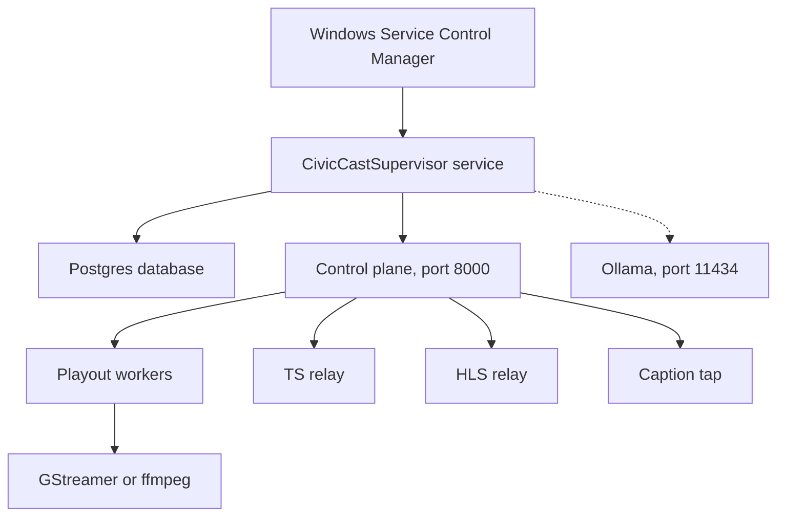

# Running it day to day: service, logs, backups, updates {#ch-operations}

This chapter is for the IT person who keeps a CivicCast station running on native Windows. It covers the one Windows service that runs everything, where the logs are, how to tell whether the station is healthy, what to check each day and each week, how disk space is used, what a backup does and does not protect, and how updates work. The [Beta 15 verification record](https://github.com/scottconverse/civiccast-native/blob/main/docs/releases/v1.0.0-beta.15-verification.md) states the package-specific observations and limits. Where the code and a convenient assumption disagree, a **Known issue** callout explains the current source behavior.

## Before you start

You need:

- An **Administrator** account on the station computer. Starting, stopping and restarting the service, reading `HKLM` registry values and reading the log folder all need elevation.
- The install folder, written `<INSTDIR>` in this chapter. The current default is `C:\Program Files\CivicCast (Native)`; a custom install can use another location. The installer places the program under it (`runtime\`, `packs\`, `dependencies\`, `models\`).
- The data folder, `C:\ProgramData\CivicCast`. Everything the station writes while it runs lives here (the code honours the `PROGRAMDATA` environment variable if it is set differently).
- An elevated PowerShell window for the commands below.

> **Note:** Earlier descriptions of CivicCast mention a message bus called NATS. NATS JetStream was removed from the product and is not part of beta.11. Do not look for it, monitor it or open a firewall port for it.

> **Note:** The [Beta 15 verification record](https://github.com/scottconverse/civiccast-native/blob/main/docs/releases/v1.0.0-beta.15-verification.md) records the package installation observations and limits. Historical station measurements are collected in [Appendix H](#app-evidence).

## What the service runs

CivicCast on Windows is one Windows service named **CivicCastSupervisor** (display name **CivicCast Native Supervisor**). It starts automatically at boot as the restricted virtual account `NT SERVICE\CivicCastSupervisor` and is registered so that Windows restarts it on failure: restart after 5 seconds, then 10 seconds, then 30 seconds, with the failure count resetting after 86,400 seconds (one day). Existing default LocalSystem installations migrate their profile and CivicCast credentials before the account changes. An isolated Windows Sandbox run with the current source overlay verified profile and CivicCast credential migration, startup under this virtual account, and a healthy API with the current schema. This is development-source evidence, not qualification of a rebuilt or signed installer or production cutover; see the [restricted service identity guide](https://github.com/scottconverse/civiccast-native/blob/main/docs/ops/restricted-service-identity.md). The supervisor starts and watches a small number of child programs. Everything else (the playout workers, relays and caption tap) lives inside the control plane child.



*Figure: the processes CivicCast runs. A solid arrow means the parent starts and restarts the child; the dotted arrow means the child is optional.*

The supervisor itself starts only three kinds of child, in this order: **Postgres** first, then the **control plane**, then **Ollama** if it is present. The control plane is the CivicCast application (a Python web service). It listens on a configured loopback address (`127.0.0.1` by default, or `::1`) and runs the playout workers, the transport-stream relay, the HLS relay and the caption tap itself. Those are not separate Windows services and you do not manage them individually. Supported remote HTTPS uses Caddy in front of this listener; see the [network access guide](https://github.com/scottconverse/civiccast-native/blob/main/docs/ops/network-access.md).

| Piece | What it is | Who starts it | Notes |
| --- | --- | --- | --- |
| Postgres | The station database | Supervisor | Listens on `127.0.0.1` only. Uses the first free port of 5432, 5433, 5434, 5435, 5544. Password logins only (`scram-sha-256`), no TLS. |
| Control plane | The CivicCast application and its web API | Supervisor | `python -I -u -m uvicorn civiccast.app:create_app --factory --host <configured loopback> --port <configured port>`. Network Settings accepts `127.0.0.1` or `::1`; do not expose the app listener directly. |
| Ollama | The local AI model server used for summaries and similar tasks | Supervisor | Optional. Started only when both `dependencies\ollama\ollama.exe` and a model store with a `manifests` folder exist. Listens on `127.0.0.1:11434`. When skipped, it shows as `stopped` with a reason, and the supervisor re-checks every 60 seconds. |
| Playout workers | The processes that put your channel on the air | Control plane | The playout engine is GStreamer by default. The older ffmpeg concatenation engine is used only when `CIVICCAST_EGRESS_ENGINE` selects it. |
| TS relay | Sends a transport stream (for a headend encoder) | Control plane | Uses TSDuck (`tsp.exe`). Automatic mode runs only when `tsp` is present. |
| HLS relay | Sends a web stream | Control plane | Supervised `ffmpeg` process. |
| Caption tap | Listens to the channel audio for live captions | Control plane | Runs inside the control plane. Live captions are off by default; `CIVICCAST_CAPTION_TAP=off` forces them off. |

If CivicCast finds another CivicCast runtime active on the same computer (the older WSL-based product), the supervisor refuses to start the station and reports `blocked_wsl_active`. See [If it did not work](#ch-operations-did-not-work).

### Supervisor states

The supervisor keeps one of seven states internally. The operator console does not show these internal names; use `/health`, `civiccast runtime status` and `supervisor.log` to see the effects described below.

| State | Meaning |
| --- | --- |
| `starting` | Children are being started in order. |
| `ready` | Postgres and the control plane are up and the control plane answered its health check. |
| `degraded` | Something is wrong but the supervisor is still running: a child is failing to stay up, or a restart storm was detected (see below). |
| `blocked_wsl_active` | The dual-runtime guard found the older WSL runtime active and refused to start. |
| `blocked_probe_unavailable` | The guard could not tell whether the older runtime is active and refused to start. |
| `maintenance` | The control plane is running in maintenance mode (no workers, no changes). |
| `stopping` | A stop was requested and children are being shut down. |

### How the supervisor restarts things

- A child that exits is restarted after a delay that starts at 1 second and doubles up to 30 seconds, with about plus or minus 20 percent random jitter.
- A restart storm is 5 or more restarts inside 600 seconds. The supervisor then reports `degraded` and raises an alert of kind `service-down` from source `supervisor`.
- Readiness budgets at start: Postgres 60 seconds, control plane 180 seconds (with a rule that the control plane is declared stalled if it makes no CPU progress for 60 seconds), Ollama 60 seconds.
- A normal stop gives each child 15 seconds, then force-terminates it. Postgres is stopped with `pg_ctl stop -m fast`. The control plane is stopped by a console break signal so it can drain cleanly. A Windows Job Object kills every child if the supervisor itself dies.
- A stop watchdog forces the supervisor to exit 150 seconds after a stop begins (`CIVICCAST_SUPERVISOR_STOP_WATCHDOG_SECONDS`; a value of 0 or less disables it). When it fires it reports the service as stopped and writes an entry to the Windows Event Log.
- After 3 consecutive identical start failures the supervisor writes `C:\ProgramData\CivicCast\STATION-START-FAILED.md` describing the failure. The file is removed on the next good start.

## Start, stop and restart the service

The supervisor has an internal control pipe, but beta.11 has no command-line tool that uses it. Operate the service with Windows itself.

1. Open an elevated PowerShell window.
2. Check the current state: `sc.exe query CivicCastSupervisor`
3. To start it: `sc.exe start CivicCastSupervisor`
4. To stop it: `sc.exe stop CivicCastSupervisor`
5. To restart it, stop it, wait until `sc.exe query CivicCastSupervisor` shows `STOPPED`, then start it.

You can do the same in the Windows **Services** app (`services.msc`). After a start, allow up to about three minutes for the control plane to become ready (its readiness budget is 180 seconds), then check health as described below.

> **Warning:** Stopping or restarting the service stops every playout worker and takes every channel off the air. Do it between meetings. A stop can take up to about 150 seconds in the worst case (the watchdog above).

> **Tip:** `sc.exe` error 1061 means the service cannot accept the command right now (typically a start or stop is still in progress); error 1062 means the service is not running. Neither needs action beyond waiting or starting it.

### Set environment variables for the service

CivicCast reads many settings from environment variables (the full list is in [Appendix C](#app-settings)). The service reads them from the standard Windows service `Environment` value, which is a multi-string value named `Environment` under `HKLM\SYSTEM\CurrentControlSet\Services\CivicCastSupervisor`. Each line is `NAME=value`. The children inherit them.

1. Open `regedit` as Administrator and go to that key.
2. Create or edit the `Environment` value (type **Multi-String Value**). Put one `NAME=value` per line.
3. Restart the service.

> **Known issue (beta.11):** The installer does not create a service `Environment` value for optional variables. Create it yourself when a setting requires one, and check it again after every upgrade.

> **Note:** The database address comes from the registry value `HKLM\SOFTWARE\CivicCast\Native\DatabaseUrl`, which SYSTEM, Administrators and the station service identity can read. The supervisor copies it into the control plane's environment unless `DATABASE_URL` is already set in the service environment, in which case the environment wins. `supervisor.log` records which source won.

## Read the logs

Service logs are in `C:\ProgramData\CivicCast\logs`. GStreamer worker logs are
under each channel's egress work folder, in its `logs` subfolder.

On **System Health → Egress storage**, check worker-log bytes and file count,
command-history rows and database storage, pending commands, and free space on
the work volume. The panel warns below 20 GiB free. An unavailable measurement is
shown as unavailable, rather than zero.

Each GStreamer stdout/stderr stream rotates at 10 MiB and keeps ten older files.
An older oversized active log is reduced to its newest 10 MiB before the next
worker starts. If the disk cannot accept diagnostics, CivicCast continues draining
the worker output so logging does not stall playout. Free disk space to restore
diagnostic logging; this does not make a full disk safe for recordings.

Consumed egress command history is trimmed in batches of up to 1,000 when a
channel exceeds 10,000 consumed commands. Pending commands are preserved. Database
space can be reused after pruning without immediately shrinking the database file.
These limits do not delete recordings or retain live-caption audio evidence.

| File | What is in it | Rotation |
| --- | --- | --- |
| `supervisor.log` | The supervisor: state changes, child starts, exits, restarts, readiness checks, the stop watchdog. The first line is `supervisor logging initialized` with the process id and the log destinations. | 10 MiB per file; keeps 10 older files (up to 11 files total). Each record is flushed to disk. |
| `control_plane-app.log` | The CivicCast application's own log (playout, schedule, captions, alerts). | 10 MiB per file; keeps 10 older files (up to 11 files total). Written only when the control plane runs under the supervisor. |
| `control_plane.log` | Raw standard output and error of the control plane, including the web server's access log (one line per request). | 10 MiB per file; keeps 10 older files (up to 11 files total). |
| `postgres.log` | PostgreSQL startup and server messages. The supervisor drains the inherited standard-output pipe after `pg_ctl` exits. | 10 MiB per file; keeps 10 older files (up to 11 files total). |
| `ollama.log` | Output of the Ollama child, when it runs. | None. |

After upgrading, an existing `control_plane.log` or `postgres.log` larger than 10 MiB rotates into an older copy without being shortened. That copy can exceed the normal size limit until later rotations replace it. New output follows the limits above; upgrading does not immediately reclaim space used by older logs.

The supervisor also writes some failures (for example the stop watchdog) to the Windows **Application** event log. In testing we could not confirm the source name Windows displays for them.

Other logs you may need:

- `C:\ProgramData\CivicCast\install-progress.log`: the installer's record of a first install.
- `C:\ProgramData\CivicCast\upgrade\upgrade-engine.log`, `upgrade-journal.json` and `UPGRADE-RECOVERY.md`: the upgrade engine, described below.

To follow a log live:

```powershell
Get-Content C:\ProgramData\CivicCast\logs\supervisor.log -Tail 50 -Wait
```

## Check that the station is healthy

### The health endpoint

The control plane answers `GET /health` (also at `/api/health`) with no sign-in. Run it from the station computer:

```powershell
Invoke-RestMethod http://127.0.0.1:8000/health
```

The HTTP status is 200 whenever the control plane is alive, even if it is unhealthy. Read the body, not the status code. The fields are:

| Field | Values | Meaning |
| --- | --- | --- |
| `status` | `healthy`, `degraded` | `healthy` requires a current database schema and no degraded or unknown live-caption verdict. This is not proof of every output or device. |
| `version` | text | The running CivicCast version. |
| `schema` | `current`, `behind`, `not-configured`, `unknown` | Whether the database matches this version of the program. |
| `live_captions` | `disabled`, `idle`, `unknown`, `degraded`, `healthy` | Coarse caption readiness; authenticated System Health identifies affected channels. Disabled captions and channels that are not on air do not themselves make readiness degraded. |
| `schema_db_revision`, `schema_expected_head` | text | The database's schema revision and the one this version expects. They differ when `schema` is `behind`. |
| `mode` | `normal`, `maintenance` | In `maintenance` the body also shows `workers_started: false` and `mutating_disabled: true`. |

> **Warning:** A monitoring tool that only checks for HTTP 200 will report a degraded or maintenance-mode station as fine. Alert on `status` not equal to `healthy`, and on `mode` not equal to `normal`.

Two more public endpoints give small answers: `GET /api/version` and `GET /api/hardware`.

### The Readiness screen

Signed in, open **Readiness** (page heading **Safe to broadcast**, section **System Health**). It is the station's own summary of whether it can go on air. Its controls are described in [Chapter 8](#ch-something-wrong). The same data is available to staff as `GET /api/staff/runtime-safe-to-air` (any of the five roles), `GET /api/staff/installer/system-health` and `GET /api/staff/system-resources` (see [Chapter 15](#ch-integrations) for calling the API).

### Alerts

The station raises alerts for conditions including: off-air, encoder death, server crash, schema drift, relay blocked, compliance probe failure, missing media, commit failure, takeover stuck for 2 hours, AI runtime down, low disk, clock skew, database unreachable, service down, self-test failure, scheduled-recording failure or dropout, as-run outbox degraded, channel-automation failure, caption tier degraded, remote-contribution problems, and emergency-alert source unavailable.

> **Known issue (beta.11; destination editor updated in beta.12):** A fresh install seeds every alert rule with no destinations attached. With no destination, the evaluator records a "suppressed" delivery row and sends nothing. In beta.11 the rule editor could not set destinations; beta.12 adds a **Destinations** checklist to each rule card. To make an e-mail or SMS alert arrive, a Setup admin must create a destination with `POST /api/staff/alert-channels` and attach it to each rule with `PUT /api/staff/alert-rules/{rule_id}` (field `channel_ids`) or use the rule card. There is no **Send test alert** button. Until you have assigned at least one enabled destination to each rule you rely on, assume it cannot notify you and monitor from outside the station as well: poll `/health` and the Windows service state with your own monitoring tool.

### Self-tests

The station runs its own checks on a schedule. By default (the code's default settings) the **daily** self-test runs at 02:00 and the **weekly** self-test on Sunday at 03:00, both by the station computer's own Windows clock and time zone. If the service was down at that moment, the missed run happens after it comes back up.

- **Daily:** the install-time readiness path, a short playout continuity proof to a file, a backup-destination write/read/delete probe, and a ping of the AI runtime. The AI ping is advisory: if the optional AI runtime is down it warns but does not fail the box.
- **Weekly:** everything in the daily test plus a restore rehearsal, an SRT continuity proof, a TSDuck compliance probe (advisory) and an alert-channel check (advisory). A check whose tooling is not installed is left out, not recorded as a pass.

A non-passing result raises a `self-test-fail` warning and clears itself on the next clean run. Staff can read results at `GET /api/staff/self-tests` and, with the Setup admin or Support admin role, start one with `POST /api/staff/self-tests/run?kind=daily` or `kind=weekly`.

> **Note:** `civiccast dr run-drill` exercises a database backup/restore into a throwaway database; it is not a full station restore. The Setup/System Health backup-storage probe checks a small manifest round-trip, not restoration of the station database, media, configuration or provider state. Neither replaces the separate backup work later in this chapter.

### Command-line checks

These need the CivicCast command-line program. Use the full path because the installer does not add it to PATH:

```powershell
$cc = "<INSTDIR>\runtime\Lib\site-packages\bin\civiccast.exe"
& $cc doctor
& $cc doctor --disk C:\ProgramData\CivicCast
& $cc runtime status
```

`civiccast doctor` accepts `--json`, `--disk <path>` (the folder whose drive is checked; it takes a path, and without it the check uses the home folder of the account running the command) and `--profile`. `civiccast runtime status` accepts `--json` and reports which runtime (native or the older WSL one) is active. The other commands used by operators are listed in [Appendix A](#app-cli).

If `civiccast.exe` is missing, `<INSTDIR>\runtime\python.exe -m civiccast.cli` runs the same program.

## Do the daily and weekly routine

This routine uses checks that exist in beta.11.

### Each day (about five minutes)

1. Run `Invoke-RestMethod http://127.0.0.1:8000/health` on the station. Confirm `status` is `healthy` and `mode` is `normal`.
2. Run `sc.exe query CivicCastSupervisor`. Confirm `RUNNING`.
3. Open **Readiness** in the console. Confirm it says the station is safe to broadcast. Read any warning in full.
4. Look at the last lines of `C:\ProgramData\CivicCast\logs\supervisor.log` for `degraded`, repeated restarts or `service-down`.
5. Check that `C:\ProgramData\CivicCast\STATION-START-FAILED.md` does not exist.
6. Check free space on the drive that holds `C:\ProgramData\CivicCast`.
7. Read the result of last night's daily self-test (`GET /api/staff/self-tests`, or the Readiness screen).

### Each week

1. Read the result of the Sunday weekly self-test.
2. Check the size of `ollama.log`; it is not rotated. The control-plane and PostgreSQL raw output logs rotate at 10 MiB and retain ten older files.
3. Check the size of `C:\ProgramData\CivicCast\data\egress` (see the next section). The native beta.11 live-caption work area is bounded automatically and does not require weekly audio cleanup.
4. Run `civiccast egress trim-health --older-than-days 30 --dry-run` and decide whether to trim (see the next section).
5. Run the disaster-recovery drill (see below) at least when you have changed anything, and keep the report.
6. Copy the things the drill does not back up (see below) to storage that is not on this computer.

## Manage disk and cache

### Where space goes

| Folder | What it holds | Grows? | Trimmed automatically? |
| --- | --- | --- | --- |
| `C:\ProgramData\CivicCast\data\pgdata` | The Postgres database | With use | No |
| `C:\ProgramData\CivicCast\data\uploads` | Uploaded media | With use | No |
| `C:\ProgramData\CivicCast\data\egress` | Playout working files, including `conform-cache` | Yes | Yes, see below |
| `C:\ProgramData\CivicCast\data\caption-tap` | Temporary live-caption audio; `active.vtt` is in the channel's egress caption folder | Bounded in the native beta.11 runtime | Processed chunks deleted; queued audio limited, see below |
| `C:\ProgramData\CivicCast\logs` | Logs | Yes | Only the rotated logs |
| `C:\ProgramData\CivicCast\upgrade` | Upgrade engine log, journal and pre-upgrade backups | Per upgrade | No |

### The conform cache

The **conform cache** is a folder where CivicCast keeps ready-to-play copies of your videos, converted to the channel's format. It is at `C:\ProgramData\CivicCast\data\egress\conform-cache`.

- **Size cap:** `CIVICCAST_CONFORM_CACHE_GB`, default 60 (gigabytes). A value of 0 or less disables the cache. When the cache is full, the oldest copies are removed first, and a copy that is used is refreshed so it is not the oldest.
- **Plan folders:** each channel's prepared playout plan folders are limited to the 3 most recent per channel, within a budget of `CIVICCAST_PREPARED_PLAN_DIR_BUDGET_GB` (default 5 gigabytes), and a folder younger than 24 hours is not removed. Leftover scratch files are removed after 1 hour.
- **Too small a cap:** if one video's conformed copy cannot fit in the budget, preparation of that video fails with: `Conform-cache budget too small to retain '<name>'; increase CIVICCAST_CONFORM_CACHE_GB or exclude this asset.` Raise `CIVICCAST_CONFORM_CACHE_GB` in the service environment and restart.
- **Failed background conforms:** after a failed or timed-out background (warm-up) conform the station waits 6 hours before trying that asset again. The time allowed for a background conform scales with the length of the asset and is capped at 7,200 seconds.

Historical measurement: in an eight-hour lab run on an earlier development build (three channels), the cache reached 46 GB of the 60 GB cap on a drive with 810 GB free, and the longest single preparation took 389 seconds. That is not a measurement of the current package or a sizing rule. Size the cap from your own library: it should hold the conformed copies of everything you expect to air in the next several days.

> **Known issue (beta.11):** There is no free-space guard on the conform cache. The 60 GB figure is a cap on the cache, not a promise that the disk has that much room. Make sure the drive has more free space than the cap plus the database, uploads and logs, and watch the **low disk** alert (which may have no destination).

### Playout health records

The playout engine stores health telemetry in the database. Nothing trims it automatically. The only trim is the command below. It needs `DATABASE_URL` set (see the next section for how to read it) and accepts `--dry-run` and `--json`:

```powershell
& $cc egress trim-health --older-than-days 30 --dry-run
& $cc egress trim-health --older-than-days 30
```

### Caption data

**Live captions:** Ordinary live captioning creates no permanent per-cue review rows or evidence WAVs. Consumed audio is deleted after processing. Whistle's working-file ceiling is 42 waiting five-second segments per channel (210 seconds), plus in-flight inputs and the segment being written. Runtimes without Whistle's processing grace use a 12-segment ceiling. A small previous-audio overlap remains in memory for recognition. This finite file ceiling and the sustained-overload threshold serve different purposes.

The live caption file and delivery bookkeeping retain a rolling 300-second window with at most 512 cues. The live worker does not scan the caption-review archive, and archive evidence does not gate broadcast readiness. These bounds replace manual weekly live-caption cleanup. If working files exceed these bounds, report a fault rather than treating routine deletion by an operator as normal operation.

Original recordings, archived caption tracks and recorded-caption review remain available and are unaffected by these temporary live-caption limits. Analytics retention is separate: events are kept up to 366 days (`CIVICCAST_ANALYTICS_RETENTION_DAYS`, allowed range 1 to 366).

> **Historical finding (published beta.10):** The audit found unlimited live-caption review/evidence accumulation, uncovered raw chunks, growing `active.vtt`, and unpruned quarantine/collision folders. Beta.11 changes that live path; the ordinary published beta.11 runtime does not run the archive sweep or append per-cue evidence records. Its exact-package record contains only a brief output observation; the separate 36-hour dev7 overlay soak is development-station history, not package proof. Long unattended operation remains unproven for the published package.

## Back up and restore

### Station backup and restore

Use **Station backup and restore** to create, verify and restore portable station archives. The encrypted `.ccbackup` contains the database, configured station files and portable CivicCast credentials, plus every file beneath the selected media roots. Choose an absolute destination, keep the recovery passphrase separately, and verify an off-station copy. A daily UTC schedule and bounded retention are available after saving the unattended passphrase in protected station storage. The station screen shows progress and the last run; the detailed inventory, restore steps and limitations are in the [station backup guide](https://github.com/scottconverse/civiccast-native/blob/main/docs/ops/station-backup.md).

Restore is an offline maintenance operation. Stop CivicCast and other station writers, provision the replacement service/database, then use `civiccast backup inventory` to inspect archive paths and `civiccast backup restore` with explicit target mappings and the `RESTORE` confirmation. The command prompts for the passphrase. Do not overlay a running station. A database restore can complete before later file or credential copies fail, so keep the source archive and rerun after correcting a path or permission problem.

The scheduled passphrase is stored separately from the archive and schedule. Keep it available to the operator who would rebuild the station. An upgrade rollback backup remains separate and is not a substitute for an off-station `.ccbackup`.

### Database restore drill

`civiccast dr run-drill` remains a separate database restore and crash-recovery drill. It proves a backup can be restored into a throwaway database; it is not the operator's station backup or live restore workflow.

### Run the disaster-recovery drill

The drill command is:

```powershell
civiccast dr run-drill --out <dir> [--backup-dir <dir>] [--work-dir <dir>] [--database-url <url>] [--media-root <dir>]
```

| Option | Meaning |
| --- | --- |
| `--out` | Required. The folder the report is written to (`dr-drill-report.md` and `dr-drill-report.json`). |
| `--backup-dir` | Where the backup goes. Default `<out>\backup`. |
| `--work-dir` | Scratch folder for the restore and crash drills. Default `<out>\work`. |
| `--database-url` | The database to drill. Default: the `DATABASE_URL` environment variable. Only `sqlite://` and `postgresql://` addresses are accepted. |
| `--media-root` | A media folder to list in the backup manifest. Optional. |

The drill does the following:

1. **Backup.** It writes `database.pgdump` (`pg_dump --format custom` with a snapshot), `globals.sql` (`pg_dumpall --globals-only`) and `manifest.json` (table row counts and SHA-256 checksums). With `--media-root` it also records every media file's path, size and a hash of the first and last 64 KiB. It does not copy the media files.
2. **Restore.** It restores the backup into a throwaway database named `civiccast_drill_restore` on the same Postgres server (dropping and recreating that name), and it refuses to drop the production database.
3. **Verify.** It checks row counts, checksums, the schema revision, that the application can read the restored data, extensions, sequences and grants.
4. **Crash drill.** It starts a stand-in process and checks that the crash-recovery logic restarts it. This uses a stand-in and an in-memory store, and does not touch your real channels.

It exits 0 if everything passed, 1 if a drill failed, and 2 if there is no `DATABASE_URL` or the address scheme is unsupported (`No DATABASE_URL configured; pass --database-url or set $DATABASE_URL.` or `Unsupported DATABASE_URL scheme for the DR drill; use sqlite:// or postgresql://.`). Read the report: the code itself says media is a manifest and not a copy, the crash drill covers only automatic restart of a worker, and there is no hot failover.

> **Known issue (beta.11):** The drill calls `pg_dump`, `pg_dumpall`, `pg_restore` and `psql` by bare name, so Windows must find them through `PATH`. The installer does not add them to `PATH`, and the service adds only the FFmpeg folder. Run from a normal prompt and the drill can fail with `pg_dump could not be started: the executable "pg_dump" is a bare command name that could not be resolved through PATH.` The console's **Run real database restore drill** button calls the same code. The upgrade engine uses full paths and does not have this issue. Use the workaround below.

Workaround, from an elevated PowerShell window on the station:

```powershell
$inst = "<INSTDIR>"
$env:PATH = "$inst\packs\native-server-binaries\payload\bin;$env:PATH"
$env:DATABASE_URL = (Get-ItemProperty 'HKLM:\SOFTWARE\CivicCast\Native').DatabaseUrl
& "$inst\runtime\Lib\site-packages\bin\civiccast.exe" dr run-drill --out D:\civiccast-dr\2026-10-05 --media-root D:\civiccast-media
Remove-Item Env:\DATABASE_URL
```

> **Warning:** The database address contains the database password. Set it only in the window you are using, never write it to a file, a script or a support ticket, and clear it afterwards as shown.

The `--out` folder must have room for a full copy of the database. Choose a drive that is not the station's data drive when you can.

### What the archive covers

The station archive uses the installed integration's configured database, files, portable credential adapter and selected media roots. It is encrypted before publication; do not copy individual machine-protected DPAPI or Windows Credential Manager blobs as a substitute. Program files, packs and models are not part of the archive and must be reinstalled. Review the exact inventory and the portable credential boundaries in the [station backup guide](https://github.com/scottconverse/civiccast-native/blob/main/docs/ops/station-backup.md).

## Recover from a disaster

The station archive is intended for a replacement installation: provision the station, stop all writers, inventory the archive, map old paths to their replacement locations, restore, import portable credentials and verify service health before returning to air. Use the [station backup guide](https://github.com/scottconverse/civiccast-native/blob/main/docs/ops/station-backup.md) for the complete sequence and failure boundaries. Keep installer rollback and station disaster recovery as separate copies and procedures.

## Update and upgrade

An upgrade runs the new `setup.exe` over the existing install. The installer includes an upgrade engine, which acts in this order:

1. It takes a verified database backup to `C:\ProgramData\CivicCast\upgrade\backups\pre-<new_version>`.
2. It upgrades the program and migrates the database.
3. If a step fails, it rolls back automatically, restoring the database from that backup in a single transaction.

It writes `upgrade-engine.log`, `upgrade-journal.json` and, if a rollback itself fails, `UPGRADE-RECOVERY.md`, all under `C:\ProgramData\CivicCast\upgrade`. Setup's exit codes tell you what happened:

| Setup exit | Engine code | Meaning | What to do |
| --- | --- | --- | --- |
| 0 | 0 | Upgrade committed | Check `/health` |
| 124 | 10 | Upgrade failed and was rolled back | Read `upgrade-engine.log`. The installer stops the service and sets it to manual start on purpose, because the new program files are already in place over the old, unmigrated database. Do not set it back to automatic by hand; fix the cause and run setup again, and a successful run restores automatic start. |
| continue | 11 | Fresh install, nothing to upgrade | None |
| continue | 12 | Same version already installed | None |
| 129 | 13 | The installer is older than the installed version | Use the newer installer |
| 113 | 20 | Rollback failed | Read `UPGRADE-RECOVERY.md` first |
| 114 | 30 | A migration cannot be restored | Read the engine log; do not retry blindly |
| 128 | 31 | A stale journal from an earlier attempt exists | Move `upgrade-journal.json` aside; do not delete it |
| 115 | other | Other failure | Read the engine log |

Related provisioning exits: 75 maps to setup exit 116, 87 to 135 (another CivicCast product or the WSL runtime is present), 85 to 127.

> **Upgrade verification:** Read the [Beta 15 verification record](https://github.com/scottconverse/civiccast-native/blob/main/docs/releases/v1.0.0-beta.15-verification.md) for the exact installer and completed checks. It does not claim a normal cross-version upgrade. Before upgrading an on-air station, take a separate backup and schedule a maintenance window with the recovery kit available.

> **Warning:** Do not upgrade during a meeting. The upgrade stops the service and takes every channel off the air.

After any upgrade, run through the daily routine, then run the drill.

## Capacity guidance

The 72-hour three-channel host measurement is recorded in the [host report](https://github.com/scottconverse/civiccast-native/blob/main/docs/ops/beta11-host-caption-performance-72-hour-2026-10-11.md). Historical Beta 12 upgrade observations are described in the [verification record](https://github.com/scottconverse/civiccast-native/blob/main/docs/releases/v1.0.0-beta.12-verification.md).

- The cache cap default is 60 GB. A 3-channel, 8-hour lab run used 46 GB of it.
- The longest conform in that run took 389 seconds.
- That run used a single service process and had 0 holes in 50 program changes.
- Known limits from the same evidence: live-caption audio can be dropped under heavy load (13 catch-up discards in 8 hours), there were two program-change aborts that recovered themselves, and one single-frame drop. DeckLink SDI output and a real cable headend are unproven. The separate 72-hour, three-channel host measurement is documented in the [72-hour host report](https://github.com/scottconverse/civiccast-native/blob/main/docs/ops/beta11-host-caption-performance-72-hour-2026-10-11.md).

Hardware sizing (CPU, memory, number of channels) is in [Chapter 9](#ch-planning) and is not repeated here.

> **Historical beta.10 finding:** An earlier audit reported a program-change watchdog gap. The current daemon includes a reload-stall watchdog that reissues a stuck rollover once, then restarts the channel if it remains pinned. That recovery is code behavior, not evidence of long-duration reliability; compare the as-run log with the schedule and consult the current verification record for package test scope.

## If it did not work {#ch-operations-did-not-work}

| What you see | Cause | What to do |
| --- | --- | --- |
| `sc.exe start` returns but `/health` never answers | Control plane still starting, or failed | Wait up to 3 minutes. Then read the last 100 lines of `supervisor.log` and `control_plane-app.log`. |
| `STATION-START-FAILED.md` appears | Three identical start failures in a row | Read the file. It names the failing child and error. Fix it, then start the service. |
| State `blocked_wsl_active` | The older WSL-based runtime is active on this computer | Run `civiccast runtime status` to see which runtime is active. The dual-runtime guard refuses to start the native station while the older runtime is active; see [Chapter 10](#ch-installing). |
| State `blocked_probe_unavailable` | The guard could not tell whether the WSL runtime is active | Run `civiccast runtime probe` and read its answer. |
| `/health` says `degraded`, `schema: behind` | Database older than the program | Do not edit the database. Check whether an upgrade stopped partway; read `upgrade-engine.log`. |
| `/health` says `mode: maintenance` | The control plane started without workers | Read `control_plane-app.log`. No channel plays in this mode. |
| `service-down` alert | Restart storm: 5 or more restarts in 10 minutes | Read `supervisor.log` for the repeating child and its exit reason. |
| `Conform-cache budget too small to retain '<name>'...` | The cache cap is smaller than that one file's copy | Raise `CIVICCAST_CONFORM_CACHE_GB` and restart. |
| `pg_dump could not be started: the executable "pg_dump" is a bare command name...` | PATH defect | Use the drill workaround above. |
| Disk full | Cache, logs, caption data or uploads grew | Stop the service, free space (logs first), then start. Do not delete files from `pgdata`. |
| Ollama shows `stopped` | `ollama.exe` or the model store is missing | The supervisor skips Ollama when its program or model store is absent. Nothing else depends on it. |
| Setup exit 135 during install | Another CivicCast product or the WSL runtime is present | See [Chapter 10](#ch-installing). |

## Related

- [Planning your station](#ch-planning)
- [Installing, first run, upgrading, uninstalling](#ch-installing)
- [Configuring the station](#ch-configuration)
- [Security and privacy](#ch-security)
- [Troubleshooting matrix](#ch-troubleshooting)
- [When something looks wrong](#ch-something-wrong)
- [Appendix A: command-line reference](#app-cli), [Appendix C: settings](#app-settings), [Appendix H: measured evidence](#app-evidence)

<!-- SOURCES: civiccast/native/supervisor/config.py, children.py, core.py, service.py, service_host.py, service_env.py, states.py, start_failure_marker.py, install_layout.py, admin.py, authz.py; civiccast/apps/installer/src-tauri/src/native_service_registration.rs (service registration, failure actions); civiccast/app.py (/health body); civiccast/native/station_runtime.py; civiccast/native/provision/conf.py, models.py (postgresql.conf, DatabaseUrl); civiccast/alerting/self_test.py, worker.py (schedule 02:00 daily, Sunday 03:00 weekly), evaluator.py, models.py, router.py; civiccast/egress/preparer.py (conform cache), env_vars.py, automation.py; civiccast/captions/retention.py; civiccast/analytics/store.py; civiccast/dr/backup.py, report.py, crash_drill.py, __init__.py; civiccast/cli.py:2689-2745 (dr run-drill), egress trim-health; civiccast/installer/service.py:1380-1530 (run_dr_drill); civiccast/native/upgrade/__main__.py, orchestrator.py, seams.py; ops/docs-sprint/inventory/generated/cli.md, generated/api.md, screens/health.md, installer-nsis-upgrade-database.md, installer-install-layout.md; docs/releases/v1.0.0-beta.10-verification.md; ops/beta10-oversight/audits/audit-lite-whole-repo-beta10-2026-10-02.md (A-001, A-004, A-008, B-003, B-004, B-005, B-009, C-001) -->
